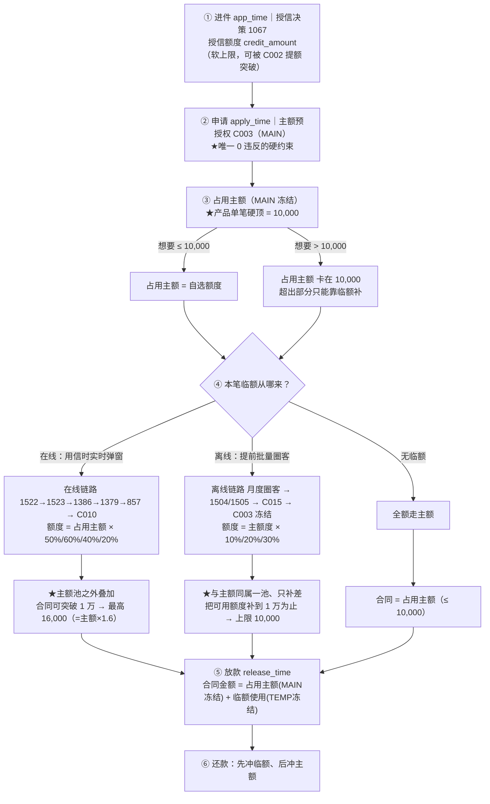
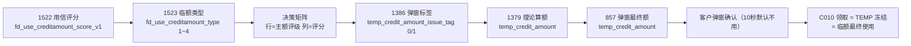
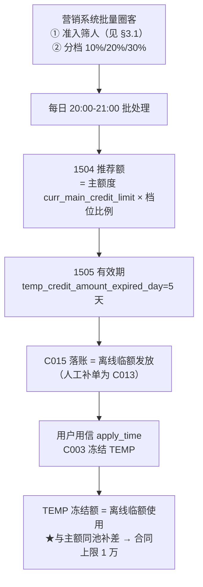

# 墨西哥临额（TEMP Limit）机制与链路说明

> 用途：给同事讲清楚「临额整体 / 在线临额 / 离线临额」的圈选逻辑、链路、时间节点与典型案例。
> 决策摘要（结论 → 依据 → 怎么调 → 预计反馈）见配套《临额机制与链路_结论版.md》。
> 读法：正文中「a / b / c / d」形式的多值，除注明外均按 **2026-07 / 08 / 09 / 10（10 月为 1-15 日半月）** 顺序排列。
> 数据窗口：2026-07-01 ~ 2026-10-15（复贷老客放款口径 `tenant='yawey' and is_reloan='old' and if_issue=1`）。
> 金额单位：**比索（MXN）**。核心底表：`mx.wxs_application_funnel`、`ods.s21_risk_model_record`、`ods_view_presto.s05_user_creditlimit_change_record`、`ods.s05_user_creditlimit_used_detail`。
> 明细宽表：`mx.tmp_online_temp_limit_wide`（逐笔 60 列）。

---

## 一、临额整体：先建立框架

### 1.1 什么是临额

临额（TEMP Limit）= 在主额度之外、**临时追加、有有效期**的额度。它和主额度**共用同一个额度账户**：一笔放款的额度由「主额冻结（MAIN）」+「临额冻结（TEMP）」两部分组成。

> ⚠️ **但"共用账户"不等于"共用上限"**：**在线临额在主额池之外叠加**（能让合同突破 1 万），**离线临额与主额同池补差**（上限就是 1 万）。详见 §1.5、§1.6。

三条必须记住的规则：

| 规则 | 说明 |
|---|---|
| **使用顺序** | 先消耗**主额**，主额不足时才动用**临额** |
| **还款顺序** | 先冲**临额**、后冲主额（防止敞口扩大） |
| **额度池恒等式** | `合同金额 = 占用主额(MAIN冻结) + 临额使用(TEMP冻结)`，逐笔成立 |

三个容易混淆的"金额"必须区分：
- `credit_amount` = **授信额度**（用户能借的上限，节点 1067）
- `risk_credit_limit` = **本笔占用主额**（这笔实际冻结的主额，落 `used_detail`）
- `temp_grant_amount` = **本笔实际使用的临额**（`/1000` 后为比索；已含在合同金额内，**不能再与主额相加**）

### 1.2 在线 vs 离线：一张表说清区别

| 维度 | 在线临额 | 离线临额 |
|---|---|---|
| 触发时点 | **用信时**（点借款按钮后毫秒级决策） | **用信前**，营销系统批量圈客 |
| 客户感知 | 用信成功后**弹窗**，全用或不用（10 秒默认不用） | **被动到账**，有效期内随借随用 |
| 圈选粒度 | biz_id 级（实时进件） | **MID 级名单**（分批上传） |
| 额度变更事件码 | **C010** | **C015**（标准）/ C013（人工补单） |
| 发放额决定 | **占用主额** × 类型比例（type1/2/3） | **主额度** × 档位比例（10%/20%/30%，见 §3.4） |
| 与主额的关系 | **主额池之外叠加**（可突破 1 万） | **与主额同池补差**（上限 1 万） |
| 有效期 | **3 天**（节点 1379） | **5 天**（节点 1505） |
| 决策落库 | `ods.s21_risk_model_record` 节点 1522/1523/1386/1379/857 | `ods.s21_risk_model_record` 节点 1504/1505 |

### 1.3 临额整体链路图（含 1 万设卡）



**怎么读这张图（三条要点）**：
1. **1 万设卡发生在第 ③ 层**——"占用主额（MAIN 冻结）"是产品单笔硬顶 10,000；用户想要更多时**不是被卡死，而是超出部分改由临额补足**。
2. **在线 / 离线的真正区别不在"从哪来"，而在"临额和主额是不是同一个池"**——在线临额**在主额池之外叠加**（所以能突破 1 万，最高 16,000）；离线临额**与主额同池、只做补差**（所以上限就是 1 万）。
3. 不管走哪条路，最后都收敛到 **`合同金额 = 占用主额 + 临额使用`** 这条恒等式（第 ⑤ 层）。

### 1.4 事件码总表（`s05_user_creditlimit_change_record`，必带 `limit_type`）

| 事件码 | action | 含义 | 粒度 | 触发时点 |
|---|---|---|---|---|
| C009 | CHANGE_LIMIT | 授信落账（主额） | 账户 | 进件时刻 |
| C002 | CHANGE_LIMIT | 申请时主额提额 | 账户 | app→apply 之间 |
| C003 | FREEZE_LIMIT | 预授权/冻结（主额=总额度授权；临时=本笔临额占用） | 笔级 | apply 时刻 |
| C004 / C008 | UNFREEZE_LIMIT | 解冻（C004=还款释额；C008=用信失败释额） | 笔级 | 还款/失败 |
| **C010** | — | **在线临额发放**（= 用户点"使用"） | 笔级 | 用信确认页 |
| **C015** | — | **离线临额发放**（营销批量推送） | 名单级 | 批量批处理 |
| **C013** | — | **离线临额发放**（9 月人工补单/修单，异常口径） | 名单级 | 人工 |

> ⚠️ **区分在线/离线的唯一判定点** = 事件码：`C010`→在线；`C013`/`C015`→离线。
> ⚠️ 不能用 `temp_grant_amount` 区分（它已把在线+离线混在一起）；不能用 `temp_credit_amount_issue_tag` 当"发放"（它只是决策层的"弹窗展示"标签）。

### 1.5 额度链路钳制关系：谁在卡、谁不卡

> 口径：复贷老客放款 58,927 笔，2026-09-01 ~ 10-15。

从"授信额度"到"合同金额"共 5 层，**真正卡人的只有 1 个**：

| 层级 | 字段 / 节点 | 是否硬约束 | 关键证据 |
|---|---|---|---|
| ① 授信额度 `credit_amount`（1067） | 用户能借的上限 | **软上限** | avg 4,030 / max 35,000；可被 C002 提额突破，**5,237 笔合同 > 授信** |
| ② 单日可借 `daily_max_available_limit`（1067） | 授信时刻快照 | **不参与放款钳制** | avg 2,684 / max 10,000；**2,072 笔占用主额 > 日帽照常放款**；同层顶帽率均匀 13~14% = 软引导 |
| ③ **C003 主额预授权**（`external_id`=本 biz） | 本笔主额授权额度 | **★唯一 0 违反的硬约束** | avg 4,323；`occ_gt_auth = 0`（无一笔占用超过预授权） |
| ④ 占用主额（MAIN 冻结） | 本笔实际冻结的主额 | **产品单笔硬顶 10,000（复贷）** | **0 笔超 10,000、114 笔正好卡顶**；9,000+ 全是散点 |
| ⑤ 临额（TEMP 冻结） | 叠加在主额之上 | 在线**池外叠加** / 离线**池内补差** | 见 §1.6、§3.4 |

**一句话**：用户"到底能借多少"由 **C003 主额预授权**（③）说了算；日帽（②）只是展示值，授信（①）是软上限；主额想借超过 10,000 时**不是被卡死，而是通过临额补足**。

**跟着真实 biz_id 逐层走一遍**（列：`授信 / 日帽 / C003预授权 / 占用主额 / 临额 / 合同`）：

| biz_id | 授信 | 日帽 | C003预授权 | 占用主额 | 临额 | 合同 | 说明 |
|---|---|---|---|---|---|---|---|
| 1620000480363920 | 32,400 | 10,000 | 35,000 | **10,000**（卡顶） | 6,000 | **16,000** | 授信 3.2 万却只借到 1.6 万；主额卡 1 万，超出部分走临额（10,000×60% type1） |
| 1620000482745719 | 11,000 | 8,000 | 17,000 | **10,000** | 6,000 | **16,000** | 日帽 8,000 低于主额 10,000 → 日帽没有起作用 |
| 1620000465426696 | 14,600 | 10,000 | 20,600 | **10,000** | 4,000 | **14,000** | 预授权比授信多 6,000（C002 提额）；临额 4,000（40% type2） |
| 1620000465665557 | 2,800 | 500 | 7,300 | **7,300**（未卡顶） | 1,450 | 8,750 | 小额笔：日帽仅 500，但预授权 7,300、主额自选 7,300 |

> ⚠️ **首贷对照（结论不同）**：首贷**无** 10,000 主额硬顶（759 笔冻结 > 1 万、max 17,250），但合同 max 仅 **9,750** 且几乎无临额兜底（34,124 笔仅 1 笔）→ 首贷被**产品支用档位直接卡死**。（首贷 C003 口径异常，不与复贷同口径比较。）

---

## 二、在线临额

### 2.1 圈选与触发逻辑（Eagle 规则引擎）

**客群范围**：**所有复贷老客**在点"借款"（用信）时**全量**进入 `1522→1523` 决策链——在线临额**没有"提前圈人"这一步**，是**用信实时算**；再由下面两道门槛筛出真正发放的人。

**策略版本（V5_2 / V5_3）由实验分桶决定**：9/3 起按 `hash(20260811｜credit_no｜app_group)` 前 16 bit 分三桶——`hash>0.7` = A 组（恒 V5_2）、`hash≤0.3` = C 组（恒 V5_3）、中间 = B 组（按时间切换）；`temp_credit_amount_strategy_test_flag` 是生产实走桶的落库标签，与 hash 互证。**同一客群在不同桶走不同版本**，这是 V5_3 放开效果能做因果对比的基础。

**是否发放**由两道门槛决定：

1. **类型门槛**：`复贷用信临额类型 ∈ {1, 2, 3}` 才触发；**type4 不触发**（几乎不发在线临额）。
2. **标签门槛**：`临额发放标签 = 1`。

**类型（type）怎么来**——由一张**决策矩阵**决定：

| | 说明 |
|---|---|
| 行 | 主额评级 `android_oldCust_mainCreditLevel_charge_V5_2 / V5_3`（整数，1 最优 → 越大越差） |
| 列 | 用信评分 `fd_use_creditamount_score_v1` 五档（≥5 / [3,5) / [1,3) / [0,1) / <0） |
| 输出 | `fd_use_creditamount_type`：1 最优 / 4 最差 |

- **V5_2**：8 级及以下才分级，8-13 全判 4（保守，基本不发）。
- **V5_3**：结构性放开——g8 全档改 2/3、g9-10 改 2/3/4、g6-7 高分段升入 1；g11+/null 仍全 4。
- 矩阵逐笔回放命中率 **94.2% ~ 98.7%**，即生产逻辑可直接做反事实测算。

**发放额比例**（占"本笔占用主额"，**不是**占授信额度）：

| type | V5_2 | V5_3 |
|---|---|---|
| type1（最优） | **50%** | **60%**（V5_3 的改动点之一，多给 10pp） |
| type2 | 40% | 40% |
| type3 | 20% | 20% |
| type4 | 不发放 | 不发放 |

### 2.2 决策链路（节点链都在 `ods.s21_risk_model_record`，只取 `strategtype='CHAMPION'`）



| 节点 | 输出字段 | 含义 | 备注 |
|---|---|---|---|
| 1522 | `fd_use_creditamount_score_v1` | 用信评分，-4 ~ 5（越高越优） | 只落总分 |
| 1523 | `fd_use_creditamount_type` | 临额类型 1~4 | 决策矩阵产物 |
| 1386 | `temp_credit_amount_issue_tag` | 弹窗标签 0/1 | **只落 tag 不落金额** |
| 1379 | `temp_credit_amount` | 理论算额（未取整） | 另带 `temp_credit_amount_expired_day=3` |
| 857 | `temp_credit_amount` | 弹窗最终额（名义发放上限） | 与 1379 取整后的值一致 |

### 2.3 金额"三段式"与算额公式（全量 99.87% 精确可还原）

```
底数          = floor(占用主额 / 20) × 20          -- 先舍到 20 比索档（主额常带 1~19 比索零头）
理论算额 1379 = 底数 × 比例(type)                  -- type1=50%/60%、type2=40%、type3=20%
弹窗额 857    = round(理论算额 / 50) × 50          -- 再四舍五入到 50 比索档
实到账 C010   = 弹窗额 857 − 发放前账户存量占用   -- = TEMP 冻结 = 临额最终使用
```

- **底数是"本笔占用主额"，不是授信额度**（这是最常见的误读）。
- 三个金额语义**严禁混用**：`理论额(1379) → 弹窗额(857，客户看到/领取的上限) → 实到账(C010，扣掉存量占用后真正进合同的部分)`。

### 2.4 时间节点（在线）

| 时点 | 取数 | 典型间隔 |
|---|---|---|
| 授信落账 C009 | `app_time` | — |
| 申请 + 主额预授权 C003 | `apply_time` | — |
| 弹窗决策完成 | 节点 857 落库（`create_time`） | 申请 → 弹窗**中位 111 秒** |
| 弹窗发放 1386 | 节点 1386 `createtime` | 恒早于使用 |
| 领取/使用 C010 | `s05...change_record.create_time` | 发放 → 领取**中位 90 秒** |
| 放款 | `release_time` | 领取 → 放款**中位约 8 分钟** |
| 临额到期 | `expiring_time` | 发放 + **3 天** |

> 关键定性：**「发放时刻(1386)」≠「使用时刻(C010)」，恒早于，中位间隔 92 秒**——客户要在确认借款页点"确认"才真正创建 C010。

### 2.5 发放 ≠ 领取（tag 与 C010 的区别，必讲）

- `temp_credit_amount_issue_tag=1` 只代表**决策层弹窗展示**（跑过 1386 决策），不代表发了额度。
- 1386 决策里**只有约 24%（tag=1）真正发放**，其余 76% 为 tag=0 未发放；把 tag=0 也算进去会大量虚增"在线临额"。
- 全窗口 tag=1 约 **53% 客户最终没领**（弹窗已发、客户未点确认），列上表现为"发放时间/弹窗额有值、使用列为空"。
- 因此：**判"在线临额发放/使用" 用 C010；判"弹窗展示" 才用 tag**。

---

## 三、离线临额

### 3.1 圈选客群逻辑

**两步走：先圈"人"（准入名单），再定"额"（档位涨幅）。**

**第一步：准入筛人**——生产 SQL（`14.墨西哥离线发临额.sql` 第 95~106 行）的 where 条件逐条照搬：

| 维度 | 条件 | 说明 |
|---|---|---|
| 逾期 | `curr_ovd_cnt_this_app_group ≤ 0` | 本包当前无逾期 |
| 逾期 | `curr_ovd_cnt_other_app_group_90d ≤ 0` | 他包近 90 天无逾期 |
| 逾期 | `id_30days_max_overdue_days ≤ 2`（或 null） | 近 30 天最大逾期 ≤ 2 天 |
| 年龄 | `age ≤ 65` | — |
| 禁申 | `if_prohibit_apply = 0` | 不在禁申期 |
| 额度 | `curr_main_limit_expire_date > 当天` | 主额度未过期 |
| 产品 | `app_group ∈ {Balam Plata, Tuna Cash, Mexcredo}` | 限定 3 个产品包 |
| 在贷 | `onloan_cnt > 0` | **必须有在贷** |
| 客群 | `is_reloan_stgy = 1` | **复贷老客** |
| 频控 | `距上次临额使用 ≥ 10 天`（或从未使用） | 控制发放频率 |

- **关键口径变化（影响坏账结构，讲的时候要点出）**：`近 30 天最大逾期 ≤ 2 天` 在 **2026-08-24 前**允许（入池占比 14%~20%），**之后收紧至 0 天**——这是 8 月下旬以来临额客群坏账上升的结构性原因之一。
- 另有 **10% 灰度对照组**（圈中但不发临额）用于效果评估。

**第二步：分档定额**——按 `V5_3 主额评级 + 还款分 + 多头分` 把客群切成 10% / 20% / 30% 三档（档位与金额公式见 §3.4）。当前批次活跃的 **30% 档**规则：

```
30% 档 = V5_3 评级 ∈ [1, 2]，或（V5_3 ∈ [3, 7] 且 还款分 + 多头分 ≥ -1）
```

- 其余 10% / 20% / 15% 档在不同批次用不同的 where 切片分配，落库后由 `temp_limit_tag` 后缀区分（`_1` / `_2` / `_3`）。
- 由**营销系统批量圈客**产出 **MID 级名单**（分批上传，同一 `activity_id` 为一批），**按月两次**批量圈客（历史口径）。

**无在贷人群另有一套实验**：**40% 发临额 + 40% 减息（后收 5%）+ 20% 对照**；该实验已验证随机平衡、可做臂间对比，而**有在贷人群是按主额分层的非随机分组，不可直接跨档对比**。

### 3.2 批处理链路（与在线 1379/857 对称，节点 1504/1505）



**节点 1504 与 C015 的对账结论**（9/1-10/14 共 30,137 条 / 10,865 mid）：
- 每条（>0）推荐额都能在 ±3 天内配上同 mid 的 **C015** 事件，时刻差 ≈ 0（C015 就是批处理落账事件）。
- **86.6%（24,748/28,573）金额完全相等**；其余差额**全为 50 的倍数**（+50 ~ +1200）= 旧的未过期临额叠加 / 凑档。
- 即：`C015 实发 = 1504 推荐额 + 叠加凑档`。

> ⚠️ 离线临额**没有专门的 tag 字段**（yj 表里 `issue_tag/strategy_flag/score` 只覆盖在线），只能靠 `change_record` 的 C013/C015 打标。
> ⚠️ **C015 = 标准离线推送（正常口径）；C013 = 9 月开发人工调整的补单/修单（异常口径，不可当常规离线统计）**。

### 3.3 时间节点（离线）

| 时点 | 取数 | 说明 |
|---|---|---|
| 批处理算额 | 节点 1504 `createtime` | 每日 **20:00-21:00** |
| 发放落账 | C015 `create_time` | ≈ 批处理时刻（±0 分钟） |
| 有效期 | 节点 1505 = **5 天** | 与早期文档"离线 7 天"不同，以实测为准 |
| 使用 | 本笔 **C003 冻结时刻** | 离线"发放≠使用"，使用由用信冻结体现 |

> ⚠️ **离线锚点必须用 `apply_time`（申请时刻），不能用 `app_time`（进件时刻）**——两者可差数天，用错会把"真离线使用"误判成"离线已过期"。

### 3.4 发放额基准与三档涨幅（`mx.yuhan_temp_limit_base_table_his_20260924` 全量验证）

**离线临额额度 = 主额度 × 档位比例**。基准是**主额度 `curr_main_credit_limit`**（即 `s05_user_credit_limit` 中 `limit_type='MAIN'` 的 `total_grantamount`），**不是本笔占用主额、也不是授信快照**。

生产 SQL（`14.墨西哥离线发临额.sql`）原始算额公式：

```
temp_limit_issue_amount
  = round( greatest( greatest(curr_main_credit_limit × ratio, curr_temp_used_credit_limit), 200 ) / 50 ) × 50
```

- `ratio` = **档位涨幅**，主用 **10% / 20% / 30%** 三档（历史另有 15% 档）；
- `greatest(..., 200)` = **保底 200 比索**；
- `round(.../50)*50` = 取整到 **50 比索档**；
- `greatest(..., curr_temp_used_credit_limit)` = **不低于"当前已用临额"**（防止降额）。

**档位由批次 `temp_limit_tag` 的后缀标识**（实测中位比例）：

| 批次后缀 | 档位 | 实测中位比例 | 示例批次 |
|---|---|---|---|
| `_1` | 10%（个别期 15%） | 10.1 ~ 15.2% | 0708/0715/0729/0805/0812/1014_1 |
| `_2` | 20% | 20.0% | 0513/0610/0624/0722/0805_2 |
| `_3` | 30% | 30.0% | 0812/0819/0826_3 |
| 无后缀（早期 0422/0429/0506） | 20% | 20.0% | 0429 / 0422 / 0506 |
| `_无在贷` | ≈30% | 28 ~ 29% | 0820/0827/0903_无在贷 |

**全量校验（120,488 行 / 41,856 mid）**：
- 发放额 ÷ 主额度 的比例**精确聚在 20%（35,743 行）、10%（18,020 行）、30%（12,176 行）、15%（5,874 行）** 四个峰位；
- 用 `{10%,15%,20%,30%}` + 200 保底 + 50 取整公式回算，**命中率 96.1%**（115,451 / 120,107）；
- 与"离线临额 / 占用主额 比值散落 0.1~2.0"**不矛盾**：基准是**主额度**，而本笔占用主额 ≤ 主额度（且离线额度 5 天有效、可被多笔复用），所以比值换算到"占用主额"必然散落。

> 📌 **与在线临额的关键区别**：在线临额 = **占用主额** × 类型比例（用信时实时算）；离线临额 = **主额度** × 档位比例（每日批处理算）。**两者基准不同，不可互相套用。**

---

## 四、在线 / 离线 的区分与共存（口径）

| 问题 | 结论 |
|---|---|
| 怎么区分来源？ | 唯一判定点：本笔 **C003 冻结时刻之前、本 mid 最近一次**临额发放事件的 `change_event_type`。`C010`→在线；`C013/C015`→离线；无发放→离线 |
| 会不会同时用两类？ | **不会**。只要本笔用了临额，其使用额恒等于本笔**一个** TEMP 账户的冻结额 |
| 同一账户怎么共用？ | 同一 mid 的在线/离线临额**挂在同一个额度账户 `limit_main_id`** 上，事件序列 发放(C010/C015)→冻结(C003)→解冻(C004/C008) 循环 |
| 混合场景怎么归？ | 只要本笔链路里出现 **C010，就全部归在线**；此时离线临额只是"持有未被消耗" |
| 离线持有但已过期、本笔其实用在线？ | 归**在线**（不能用"持有标签"判定，必须看实际冻结来源） |

**三个必须避开的误判**（都已在数据上修复验证）：
1. ❌ 只用"本笔自身有无 C010"判在线 → 会漏掉"同日同 mid 多笔申请、C010 由前面失败笔创建、被后面成功笔消耗"的场景。
2. ❌ 用 `release_time` 当锚点 → 会把更早一笔无关贷款的发放事件挂到本笔（曾污染 54.6% 的无临额笔）。
3. ❌ 用 `app_time` 当离线锚点 → 取到已过期批次，误判来源。

---

## 五、策略与效果数据

> 口径：复贷老客放款（`if_issue=1`）；"渗透率" = 有临额笔数 / 放款笔数；金额占比 = 临额使用额 / 合同金额；在线/离线的"笔占比" = 各自笔数 / 有临额笔数（二者互斥，相加 = 100%）。金额单位：比索。

| 月份 | 放款笔数 | 有临额笔数 | 临额渗透率 | 临额使用额 | 占合同金额 | 在线占合同 | 离线占合同 | 在线笔占比 | 离线笔占比 |
|---|---|---|---|---|---|---|---|---|---|
| 2026-07 | 37,885 | 8,038 | **21.2%** | 477.5 万 | 8.7% | 2.4% | 6.3% | 34.1% | 65.9% |
| 2026-08 | 36,830 | 9,668 | **26.3%** | 564.0 万 | **10.6%** | 4.2% | 6.4% | 48.5% | 51.5% |
| 2026-09 | 39,083 | 8,154 | 20.9% | 465.9 万 | 8.2% | 3.6% | 4.6% | 53.6% | 46.4% |
| 2026-10（1-15 日） | 19,901 | 4,113 | 20.7% | 234.5 万 | 7.9% | 3.8% | 4.1% | 56.6% | 43.4% |

**读法（讲给同事的 4 句话）**：
1. **渗透率**：有临额的放款笔占比 7 月 21% → **8 月峰值 26%** → 9-10 月回落到约 21%。
2. **力度**：临额使用额占合同金额 8 月峰值 **10.6%**，10 月降到 7.9%——8 月是"在线 + 离线双高峰"，与坏账跳升窗口吻合。
3. **结构迁移**：离线份额从 7 月 **66%** 一路降到 10 月 **43%**，在线份额从 **34%** 升到 **57%**——在线（尤其 V5_3 扩额）逐步顶上。
4. **风险提示**：临额本身不制造坏账（同评级内发临额客户坏账 ≤ 未发客户），坏账上升来自**客群结构下沉**与**风险向无临额长尾客群转移**。

> 表内同时保留 2026-01 ~ 06 的历史月度数据（离线在 4-5 月即已存在且份额较高，非"9 月才出现"），如需可展开。

### 5.1 10,000 合同上限：在线能破、离线破不了

> 口径：复贷 2026-07-01 ~ 10-15；"离线已用"仅取 C015（剔除 C013 人工补单）。

**核心结论：合同突破 10,000，只有"在线临额"做得到；离线临额的上限就是 10,000。**

| 维度 | 在线临额 | 离线临额 |
|---|---|---|
| 额度怎么来 | 占用主额 × 50%/60%/40%/20% | 主额度 × 10%/20%/30%（见 §3.4） |
| 与主额关系 | **主额池之外叠加** | **与主额同池补差** |
| 合同上限 | **能突破 1 万**（主额 1 万 + 临额 4,000/6,000 → 14,000/16,000） | **上限就是 1 万**（4,960 笔已用，**0 笔突破**） |

**按月影响：**

| 月份 | 在线已用笔 | 在线 合同>1万 | 在线 溢出金额 | 离线已用笔 | 离线 合同>1万 | 离线 撞顶(=1万) | 离线 被压掉 笔/金额 |
|---|---|---|---|---|---|---|---|
| 2026-07 | 2,628 | 3 (0.11%) | 3,600 | 5,406 | **0** | 87 | 101 / 237,639 |
| 2026-08 | 4,483 | 22 (0.49%) | 37,762 | 5,081 | **0** | 96 | 106 / 232,970 |
| 2026-09 | 4,247 | 51 (1.20%) | 113,212 | 3,846 | **0** | 82 | 106 / 243,255 |
| 2026-10（半月） | 2,336 | 36 (1.54%) | 77,312 | 1,864 | **0** | 49 | 64 / 158,096 |

**怎么读**：
1. **在线临额不受 1 万约束**：反而每月"制造"超万合同（7/8/9/10 月）**3 / 22 / 51 / 36 笔**，溢出金额 **3,600 / 37,762 / 113,212 / 77,312 比索**，占比 **0.11% / 0.49% / 1.20% / 1.54%**，**逐月放大**（10 月半月已到 1.5%）。
2. **离线临额被 1 万硬约束**：每月"撞顶"87/96/82/49 笔（补到 1 万即止，四个月 **0 笔突破**）；每月约 **100 笔**"主额 + 持有离线额"已超 1 万，被压掉合计 **23~24 万比索/月**（占离线已用 2.1%→3.9%，逐月上行）。
3. **溢出笔的主额并非都是顶格 10,000**：全量 112 笔溢出笔主额分布为 **10,000 占 37.5%、8,000 占 30.4%、7,000 占 16.1%、其他 16%**——只要 `主额 × (1+在线比例) > 10,000` 就会溢出（如主额 7,000 × 1.6 = 11,200）。
4. **无临额组**"合同正好 = 1 万"的笔数（7/8/9/10 月）为 0/6/46/27 笔、"合同 > 1 万"四个月均为 **0 笔** → 1 万是**纯主额的产品上限**，在线临额是**唯一突破通道**。

> 注：离线"补到 1 万"只是**上限**，不是常态——4,960 笔中仅 130 笔（2.6%）正好凑到 1 万，其余多为小额贷叠加小额临额（合同集中在 800 ~ 2,500）。

---

## 六、典型案例（真实数据复核，窗口内逐笔可追）

> 以下字段值均取自宽表 `mx.tmp_online_temp_limit_wide` 或源事件表，可复跑。

### 案例 1｜纯在线·标准算额链路（biz 1620000462179690）
- **进件** 09-01 20:41:33 → **申请** 20:44:07 → **放款** 21:15:43
- 授信额度 1067 = 1500；C002 申请时提额 → **2300**；C003 主额预授权 2300
- 主额评级 V5_2=8 / V5_3=6（策略桶 `20260810-V5_3`）；用信评分 1522 = **1**；**type 1523 = 2**
- **算额链**：占用主额冻结 = **1180** → 底数 = 1180 → 理论额 1379 = 1180 × **40%** = **472** → 弹窗额 857 = round(472/50)×50 = **450**
- 弹窗发放 1386 = 20:46:19（tag=1）；**领取 C010** = 21:05:04 → 实到账/使用 = **450**（TEMP 冻结 450）
- **合同 1630 = 主额 1180 + 临额 450** ✓
- 同 mid 还有一笔离线 C015（09-01 20:02，250）但**未被消耗**（离线使用=0），在线覆盖 ≥ 离线
- **要点**：一条标准在线链路的 1522→1523→1386→1379→857→C010 全落库、可逐笔还原。

### 案例 2｜纯离线·锚点用申请时刻（biz 1620000463039322）
- **进件** 09-04 09:38 → **申请** 09-09 08:45（**跨 5 天**）
- 离线发放 **C013** = 09-09 04:16，金额 **600**（1504 推荐额 600 @ 09-09 02:30）
- 离线**使用** = 本笔 C003 冻结 = 09-09 08:45:01，金额 **294.7**
- **合同 6200 = 主额 5905.34 + 临额 294.66** ✓
- **要点**：若用进件时刻 `app_time` 当锚点，会取到 08-25 那笔**已过期**的离线 1150 → 误判"离线已过期"。离线锚点必须用 `apply_time`。

### 案例 3｜名义额 ≠ 实到账（存量占用抵扣）（biz 1620000464027012）
- 弹窗额 857 = **1300**（理论 1379 = 底数 6500 × 20% = 1300）
- **发放前账户存量占用 = 1217.2**（历史未结清，非本笔）
- **实到账 = 1300 − 1217.2 = 82.8** = TEMP 冻结 = 临额最终使用
- **合同 6588.8 = 主额 6506 + 临额 82.8** ✓
- **要点**：只看名义发放额（1300）会**高估临额力度约 15 倍**；真实力度看"实到账"。

### 案例 4｜历史临额占用拆分（biz 1620000465328686）
- 策略桶 `20260810-V5_3`，type1 → 底数 700 × **60%** = 420 → 弹窗额 = round(420/50)×50 = **400**
- **历史临额占用 = 306.25**（未结清 306.25 / 结清后 0）；**实到账 = 93.75**
- **合同 793.75 = 主额 700 + 临额 93.75** ✓
- 来源 biz 1620000460517829（4 期，发放时刻仍在途、9/24 才结清）→ 归"未结清占用"
- **要点**：V5_3 的 type1 比例是 **60%**（不是 50%）；占用是"冻结残留"，**不是欠款也不是坏账**。

### 案例 5｜弹窗已发、客户没领（biz 1620000463197032）
- tag=1，弹窗额 857 = **250**；**无 C010**（客户未点确认）
- **合同 550 = 全额走主额**（占用主额 550）
- 宽表状态 = "已弹窗_未领取"
- **要点**：约 53% 的 tag=1 客户最终没领取；不能用 tag 当"发放"。

### 案例 6｜临额在"首次申请"发放、被后续成功申请消耗（同一账户同日 4 次申请）（biz 1620000483074755）

同一用户（mid 1040160073517835）2026-10-15 **连续申请 4 次，前 3 次失败、第 4 次成功**。全程只发生 **1 次 C010（在线临额发放）**：

| 时刻 | 事件 | 归属笔 | 金额 |
|---|---|---|---|
| 13:38:51 | C003 MAIN 冻结 | 第1次 1620000481078667 | 2,000 |
| **13:40:32.642** | **C010 TEMP 发放（唯一一次临额发放）** | 第1次 | **400** |
| 13:40:32.645 | C003 TEMP 冻结 | 第1次 | 400 |
| 13:50:43 | C008 释额（申请失败） | 第1次 | −400 |
| 13:58:29.928 | C003 TEMP 冻结 | 第2次 1620000483031943 | 400 |
| 14:05:43 | C008 释额 | 第2次 | −400 |
| 14:48:12.980 | C003 TEMP 冻结 | 第3次 1620000483065877 | 400 |
| 14:55:43 | C008 释额 | 第3次 | −400 |
| 15:02:29.958 | C003 TEMP 冻结 | **第4次 1620000483074755（成功）** | 400 |
| 15:10:43.066 | 放款 | 第4次 | 合同 **2400 = 主额 2000 + 临额 400** |

- 关键证据：**全程只有 13:40:32 那 1 次 C010**；后面 3 次重试都没有新的 C010——临额 400 早已挂在账户上（有效期内），每次重试直接"冻结→失败释额"，最后被第 4 次成功放款消耗。
- 因此本笔"type=4、tag=0（无弹窗）却用了在线临额"是**真实业务链路，不是判定错误**：临额在**首次**申请的确认页发放，后续申请复用（授信/申请触发在线临额的链路并未被打断）。
- **要点**：来源判定按"本笔 C003 冻结前最近一次发放事件"（本笔 15:02 前最近的是 13:40 的 C010）→ **判为在线正确**。若改用"本笔自身有无 C010"会把它误判成离线，这才是错的。
- **规模**：全窗口（2026-07~10）这类"跨笔领取"共 **413 笔**（占在线临额 14,125 笔的 **2.9%**）；其余 **97.1%** 的在线笔，其 C010 就属于本笔自身。**结论：链路正确，无需返工；该模式真实存在但属少数。**

### 案例 7｜"无主额"其实是占满（算额底数=本笔占用主额）（biz 1620000482769098）
- 授信额度 1067 = 34000（大额），V5_3 / type1 / V5_2 评级 5
- 弹窗 tag=1，**弹窗额 857 = 250**；**合同 450 = 全额走主额**
- 算额链：**底数 = 本笔占用主额 450**（不是授信 34000）→ floor(450/20)×20 = 440 → 1379 = 440 × **60%** = **264** → 857 = round(264/50)×50 = **250**
- **要点**：算额底数是"本笔占用主额"而非授信额度；`used_detail` 落库延迟导致"占用主额为空调"，用 `合同 − 临额` 恒等式补全即可。

### 案例 8｜存量占用跨月稳定 + 2-3 月残留 bug（同一额度账户连续 5 笔）

同一额度账户从 3 月到 10 月连续 5 笔在线临额，**发放前存量占用恒为 770.4**，把每笔名义额都"吃掉"一截（宽表复核，`hist_occupy_settled=770.4`、`hist_occupy_open=0`、台账还原差额=0）：

| 放款日 | biz_id | 名义发放 | 发放前存量占用 | 实到账临额 | 合同金额 |
|---|---|---|---|---|---|
| 2026-03-27 | 1620000401908332 | 1,350 | **770.4** | 579.6 | 2,294.6 |
| 2026-08-29 | 1620000460693942 | 1,200 | **770.4** | 429.6 | 3,425.6 |
| 2026-09-10 | 1620000465739710 | 3,600 | **770.4** | 2,829.6 | 8,829.6 |
| 2026-10-01 | 1620000474884411 | 2,800 | **770.4** | 2,029.6 | 9,029.6 |
| 2026-10-15 | 1620000483279971 | 2,400 | **770.4** | 1,629.6 | 7,629.6 |

- **770.4 从哪来**：两笔 3 月老贷 —— biz 1620000395926822（冻结 830 / 解冻 332 = 498）、biz 1620000396309679（冻结 454 / 解冻 181.6 = 272.4），两笔均 **2026-03-26 全额结清**，但**只在末期还款触发解冻、且只放末期本金** → 非末期本金 498 + 272.4 = **770.4 长期挂账**。
- 宽表复核：这两笔的 TEMP 冻结额分别为 **830 / 454**（与上式一致）；5 笔的 `hist_occupy_settled` 全为 770.4、`hist_occupy_open` 全为 0，即该占用 100% 属"结清后残留"。
- **要点**：**"已结清" ≠ "临额已解冻"**；占用是未释放的冻结残留，**不是欠款、不是坏账**。

**这类"结清后残留占用"到底有多少（宽表实测）**：

| 口径 | 笔数 | 金额（比索） |
|---|---|---|
| 本汇报窗口 2026-07~10：**结清后残留占用**（真缺陷） | **79** | **9,811** |
| 同窗口：来源贷款"未结清"的历史占用（旧贷在途的正常占用） | 332 | 127,274 |
| 全表 2026-01~10：结清后残留占用（真缺陷） | **389** | **137,461** |

- **回答"是不是都是最后一期还了"**：**是**。归入"结清后残留"的笔，其**来源贷款在本次发放前均已全额结清**（最后一期已还），但临额冻结未随结清释放——这正是缺陷特征，建议列入**待与研发/账务讨论修复**的清单。
- **时间分布**：历史占用高峰在 **2026-02~05**（每月 775~1,838 笔、53~184 万比索），**6 月起骤降**（每月 ≤175 笔、≤8.2 万）——与"6 月起不再新增来源"一致；但历史残留仍被后续新贷持续消耗（7-10 月每月仍有 12~24 笔）。

**主额是否也异常？—— 否，问题只在临额(TEMP)侧。** 对本窗口 79 笔的 37 个来源贷款逐一回查其**主额(MAIN)台账残留**：**全部为 0.0**，即来源贷款结清后主额冻结均已正常释放，**仅临额冻结残留** → 缺陷范围可明确锁定在 TEMP 维度，不涉及主额。

**"结清后残留"明细清单**（79 笔消耗笔 × 来源贷款 = 103 行）已在本地单独出表：`结清后残留临额占用明细_20260701_1015.csv`。字段：消耗笔 biz_id ／ 临额发放时刻 ／ **来源贷款 biz_id** ／ **未解冻金额(TEMP)** ／ 来源主额残留(MAIN) ／ 来源最后还款时刻 ／ 还款期数 ／ 是否真实挂账。

- **真实挂账**（未解冻 > 1 比索）：**19 行 / 9,768.9 比索**，集中在 **8 个来源贷款**：
  1620000391323947（3,204）、1620000395926822（1,992）、1620000395171700（1,350）、1620000396309679（1,089.6）、1620000396513470（666.7）、1620000395536273（600）、1620000395853691（466.7）、1620000395382948（400）。→ **建议列入待修复清单**与研发/账务核对。
- **舍入尾差**（未解冻 ≤ 1 比索）：**84 行 / 仅 42.3 比索**，为 20/50 档分档的浮点尾差，业务上可忽略。

---

## 七、口径速查与常见坑

| 坑 | 正确做法 |
|---|---|
| 用 `temp_grant_amount` 区分在线/离线 | ❌ 它是在线+离线混合后的实际使用额；用事件码 C010 / C013 / C015 区分 |
| 用 `tag` 当"在线临额发放" | ❌ tag=1 只是弹窗展示，约一半未领取；发放/使用看 C010 |
| 用 `change_total_grantamount` 衡量临额力度 | ❌ 名义发放，未扣存量占用；真实力度看 `实到账 = 名义 − change_used_grantamount` |
| 用 `app_time` 当离线锚点 | ❌ 进件≠申请，可差数天；必须用 `apply_time` |
| 把"已结清/无逾期"当成"临额已解冻" | ❌ 二者不等价；占用是未释放的**冻结残留**（2-3 月老贷 bug，6 月起已修复） |
| `used_detail` 取不到 MAIN/TEMP 冻结 | 批次落库有 T+1/T+2 延迟；用 `合同 − 临额` 恒等式补全，命中率 99.94% |
| 把 type4 也算在线临额 | ❌ type4 原则上不发放（全窗口仅 10 笔保底/边界） |
| V5_2/V5_3 比例混用 | type1：**V5_2=50% / V5_3=60%**；type2=40%、type3=20% 两版一致 |
| 把离线临额的涨幅基准当成"占用主额" | ❌ 离线基准是**主额度** `curr_main_credit_limit` × **10%/20%/30%**（在线才是"占用主额"，两者基准不同） |
| 把在线临额当成"与主额同池" | ❌ 在线临额**在主额池之外叠加**（能突破 1 万）；离线临额**与主额同池补差**（上限就是 1 万） |

**核心结论（一句话）**：临额本身不制造坏账——同评级内"发临额"客户坏账 ≤ "未发临额"客户（模型挑好客户发）；坏账上升来自**客群结构下沉**（V5_3 放开了中低评级档、离线圈客口径放松）与**风险向无临额长尾客群转移**。

---

## 附：字段名对照（宽表 `mx.tmp_online_temp_limit_wide`）

输出列一律用英文字段名，中文含义见下表：

| 英文列名 | 中文含义 |
|---|---|
| biz_id | 进件主键 |
| app_date / app_time | 进件日期 / 进件时刻 |
| apply_time / release_time | 申请时刻 / 实际放款时刻 |
| credit_amount_1067 | 授信额度 |
| daily_max_amount_1067 / credit_expire_day_1067 | 单日最大可借 / 授信有效期天数 |
| main_grade_v5_2_1500 / main_grade_v5_3_1542 / main_grade_v6_1_1635 | 三套主额评级 |
| raise_main_c002 / authorize_main_c003 | 申请时主额提额 / 主额预授权 |
| offline_grant_time / offline_grant_amount | 离线发放时间 / 金额 |
| offline_recommend_time_1504 / offline_recommend_amount_1504 | 离线批量算额时刻 / 推荐额 |
| offline_use_time / offline_use_amount / offline_status_at_apply | 离线使用时间 / 金额 / 当时状态 |
| online_issue_time_1386 | 在线临额发放时间 |
| use_credit_score_1522 / use_credit_amount_type_1523 | 用信评分 / 用信临额类型 |
| strategy_bucket_v52_v53 / exp_hash / exp_group_after_0903 | 策略分桶 / 实验 hash / 实验分组 |
| issue_tag_1386 | 弹窗发放 tag |
| calc_base_main_floor20 / theoretical_ratio / actual_ratio_1379_over_base | 算额底数 / 理论比例 / 实测比例 |
| theoretical_amount_1379 / decision_tree_label_1379 | 理论算额 / 决策树标签 |
| online_issue_amount_857 / popup_round_adjust_round50 / temp_expire_day_1379 | 在线临额发放金额 / 弹窗取整调整 / 有效期天数 |
| online_use_time_c010 / online_use_amount_c010 | 在线临额使用时间 / 金额 |
| hist_occupy_amount / hist_occupy_settled / hist_occupy_open | 历史占用 / 结清后 / 未结清 |
| popup_claim_status / is_t1_batch_rerun | 弹窗领取状态 / 决策是否 T+1 重跑 |
| temp_freeze_time_c003 / temp_occupy_amount / temp_final_use_amount | 临额冻结时刻 / 占用金额 / 最终使用 |
| temp_final_use_online / temp_final_use_offline | 临额最终使用（在线 / 离线） |
| contract_amount | 合同金额 |
| main_occupy_amount_raw / main_occupy_amount_filled | 占用主额（原始 / 补全） |
| identity_diff_diag | 恒等式差额诊断 |
