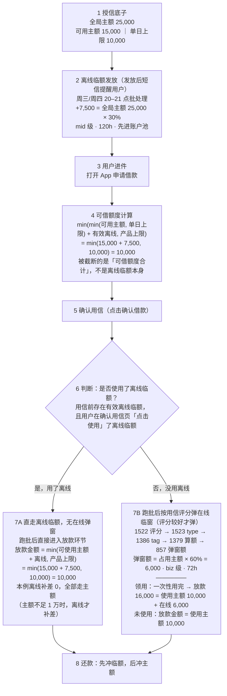

# 临额流程：额度池与时间轴（离线 vs 在线）

**示例用户**：全局主额 25,000 ｜ 可用主额 15,000 ｜ 单日可借上限 10,000 ｜ 产品上限 10,000（独立配置）

---

## ① 全流程（严格按用户路径）

**要点**

- 离线临额：每日（周三/周四）20–21 点批处理发放，短信提醒，有效期 120h，用户级（mid），算额基数 = **全局主额** × 档位比例（10%/20%/30%）
- 在线临额：确认用信后弹窗发放，有效期 72h（3 天），订单级（biz），算额基数 = **本笔占用主额** × type 比例（type1：V5_3 60% / V5_2 50%；type2 40%；type3 20%）
- 单笔只消耗一类临额：用了离线 → 无在线弹窗；没用离线 → 才进在线弹窗分支

---

## ② 额度池与 1 万闸门

规则：**离线临额与主额同池**，合计受单日可借上限/产品上限（当前均 = 10,000）钳制；**在线临额池外叠加**，可突破 1 万。

| 场景 | 主额可用 | 临额 | 实际可借 |
|---|---|---|---|
| A · 主额 15,000 + 离线 7,500 | 10,000（顶格） | 7,500 被 1 万闸门挡住，增量 0 | **10,000** |
| B · 主额 7,000 + 离线 7,500 | 7,000 | 离线补差 +3,000 | **10,000** |
| C · 主额 10,000 + 在线 6,000 | 10,000 | 在线池外叠加 +6,000 | **16,000** |

---

## ③ 时间轴

| 时刻 | 离线临额 | 在线临额 |
|---|---|---|
| 发放时点 | 用信**前**：每日 20–21 点批处理，短信提醒 | 用信**后**：确认用信 → 评分较好 → 弹窗 |
| 有效期 | 120h（5 天） | 72h（3 天） |
| 级别 | 用户级（mid），有效期内可被多笔复用 | 订单级（biz），一次性用完 |
| 算额基数 | 全局主额 × 30%（本例 7,500） | 本笔占用主额 × 60%（本例 6,000） |

---

## ④ 关键结论

1. 用信时页面可借额度为 **10,000**：min(min(可用主额, 单日上限) + 有效离线, 产品上限)，被 1 万截断的是「可借额度合计」，不是离线临额本身。
2. 确认用信时**使用了（离线）临额** → 跑批后直接进入放款环节，放款金额 = min(可使用主额 + 离线临额, 产品上限) = min(15,000 + 7,500, 10,000) = **10,000**。
3. 确认用信时**未使用临额** → 跑批后按用信评分弹在线临窗（评分较好才弹）：**领用则一次性用完** → 放款金额 = 使用主额 + 在线临额 = 10,000 + 6,000 = **16,000**；未使用 → 放款金额 = 使用主额 = 10,000。
4. 在线临额决策链：1522（用信评分）→ 1523（type）→ 1386（是否发放 tag）→ 1379（理论算额）→ 857（弹窗最终额），全链命中率约 99.9%。
5. 还款顺序：**先冲临额，后冲主额**。
