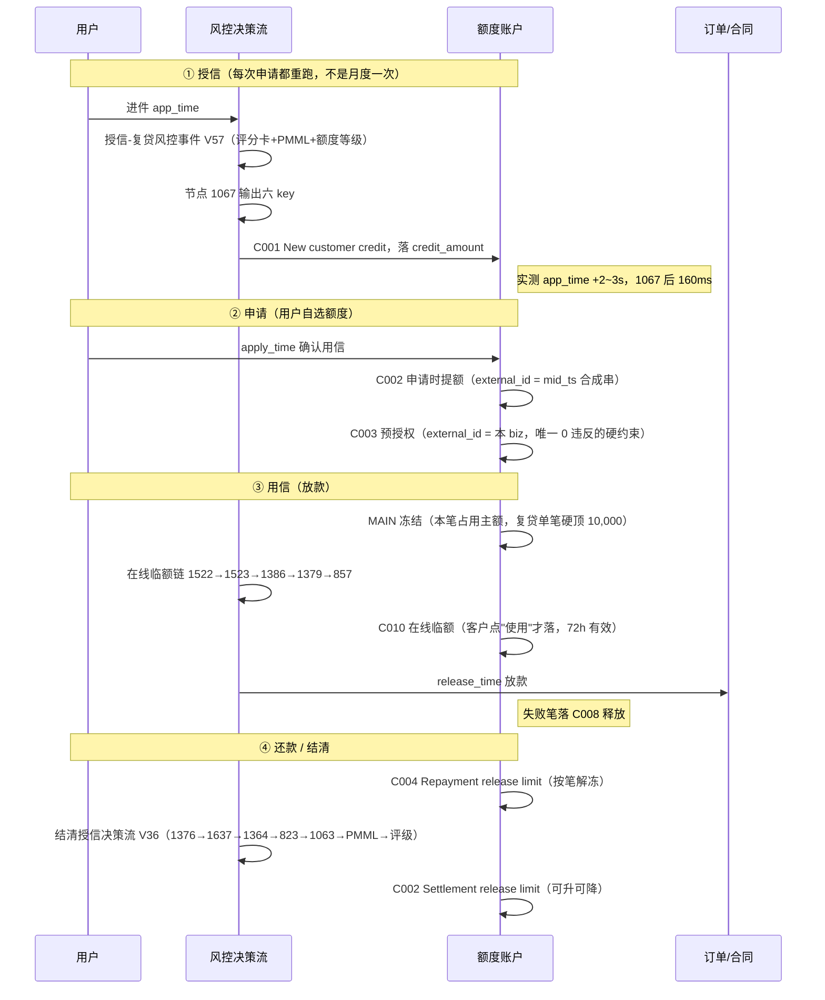
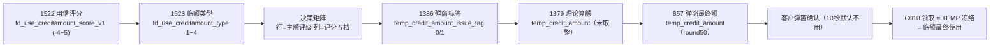
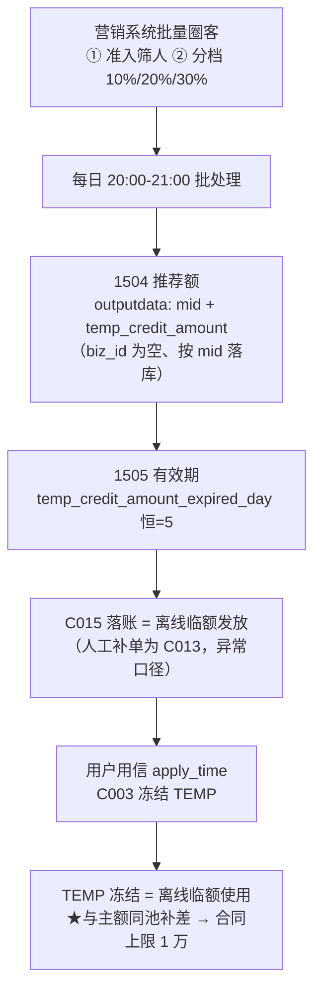
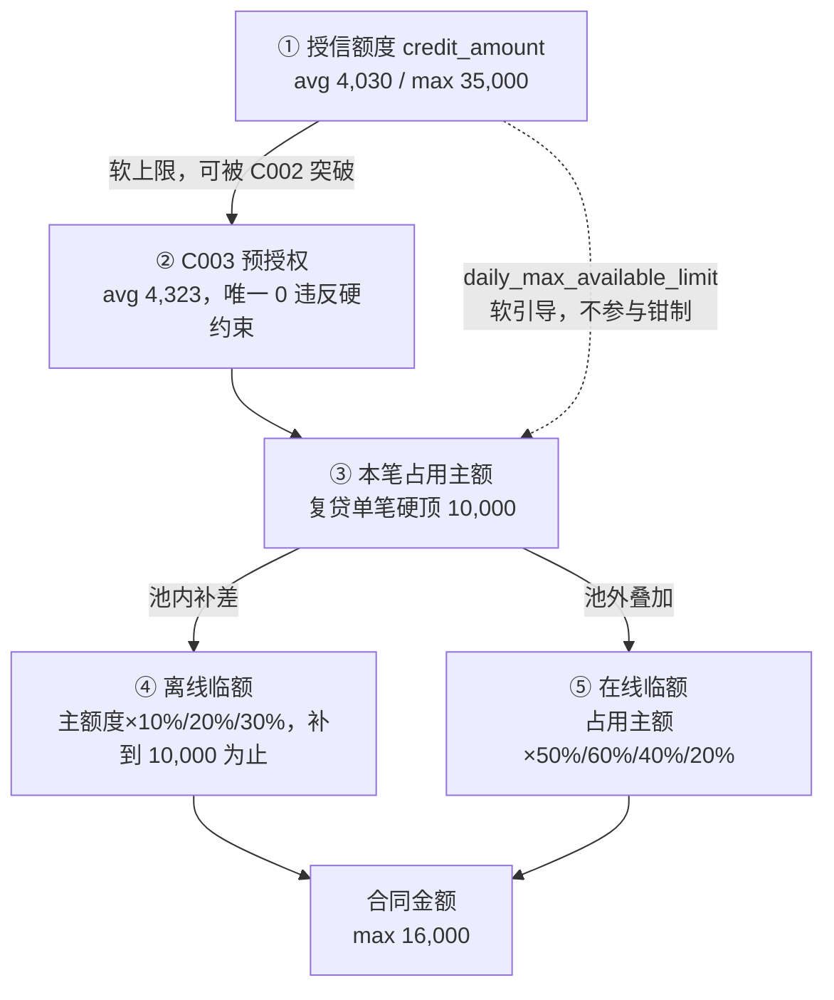
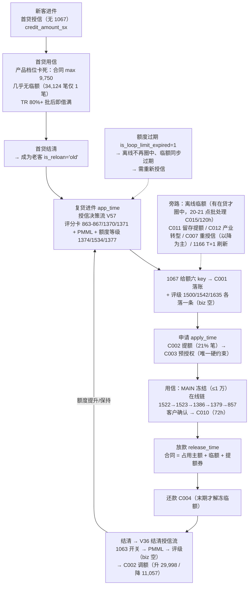

# 墨西哥循环贷 · 额度框架全解（授信 → 申请 → 用信 → 结清）

> 目的：把「什么时候给额、按什么规则给、评级怎么产生、评级怎么影响额度」串成一张**节点级、公式级、案例级**可追溯的图。
> 所有节点号、事件码、系数都落到源表；每个结论标注证据与实测数字；未打通的明确写「未打通」，不猜。
>
> 配套文档：[临额机制与链路汇报.md](临额机制与链路汇报.md)（临额细节、8 个真实案例）
> 口径来源：`.trae/skills/mexico-temp-limit-analysis/SKILL.md` 及其 references；本文全部数字为 2026-10 月多轮实测。
> 金额单位：**比索（MXN）**；库内时间 = **墨西哥当地时间**（看板 UI = 北京 = 库内 +14h）。

---

## 0. 一句话总览

**额度不是一个数，而是「3 层账户 × 4 个时点 × 3 套评级 × 2 类临额」的组合；评级不管"给多少授信"，只管"给不给临额、给多少比例"。**

| 维度 | 内容 | 一句话 |
|---|---|---|
| 3 层账户 | MAIN 主额度 / TEMP 临时额度 / VOUCHER 提额券 | 三个池子，`s05_user_credit_limit.limit_type` 区分 |
| 4 个时点 | 授信 → 申请 → 用信 → 结清 | 每个时点都写一次额度流水（change_record） |
| 3 套评级 | V5_2(节点1500) / V5_3(1542) / V6_1(1635) | 同一时刻并行落三条，串行迭代 |
| 2 类临额 | 在线（用信弹窗实时算）/ 离线（每日 20-21 点批处理） | 在线**池外叠加**能破 1 万；离线**池内补差**上限 1 万 |
| 1 条主线 | 评级 → type → 是否发临额 → 发多少 | 授信额由 `credit_amount` + 用户自选决定 |

**关键认知纠正**：很多人以为「评级决定额度」。实际两条线是分开的：
- **额度线**：授信 `credit_amount`（1067 节点）→ C002 申请提额 → C003 预授权 → 占用主额（硬顶 1 万）
- **评级线**：1500/1542/1635 评级 → 决策矩阵 → `fd_use_creditamount_type` → 临额比例（50%/60%/40%/20%/0）
- 两条线在**用信**这一步才交汇：合同 = 占用主额 + 临额。

---

## 1. 账户层：三个池子

### 1.1 账户结构

```
mid (用户)
 ├── MAIN  主额度   total_grantamount / used_grantamount / expiring_time（授信有效期 15~30 天）
 │        └── daily_max_available_limit（单日最大可借，软引导，不参与放款钳制）
 ├── TEMP  临时额度 与 MAIN 共用 limit_main_id 账户，独立 total/used/expiring_time
 │        ├── 在线：有效期精确 72h（C010 发放，用信确认页弹窗）
 │        └── 离线：有效期精确 120h（C015 发放，每日 20-21 点批处理）
 └── VOUCHER 提额券  voucher_limit，不扣主额、不扣临额
```

- **同一 mid 的在线/离线临额挂在同一个 `limit_main_id` 额度账户上**，事件序列 发放(C010/C015) → 冻结(C003) → 解冻(C004/C008) 循环。
- 使用顺序：先消耗**主额**，主额不足才动用**临额**；还款冲账顺序相反：**先冲临额、后冲主额**（防风险敞口扩大）。
- 主额度过期时**同步使临额过期**（需求文档《25.11.26-新增临时额度管理体系》V1.4）。

### 1.2 四张表的分工（别混用）

| 表 | 粒度 | 回答什么问题 | 关键字段 |
|---|---|---|---|
| `ods.s05_user_credit_limit` | 账户 × limit_type | 现在还剩多少（余额快照） | total_grantamount / used_grantamount / expiring_time / limit_type |
| `ods_view_presto.s05_user_creditlimit_change_record` | 事件 | **谁在什么时候因为什么改了额度**（流水主表，无 biz_id 按 mid 关联） | change_event_type / change_action / change_total_grantamount / change_used_grantamount / old_total_grantamount / expiring_time / external_id / limit_main_id |
| `ods.s05_user_creditlimit_used_detail` | 笔 × limit_type | 这一笔占用了多少（冻结明细，有 biz_id） | risk_credit_limit / change_action='FREEZE_LIMIT' / limit_type |
| `ods.s21_risk_model_record` | 节点 | 决策流每一步算了什么（评级/评分/算额） | modelmainid / strategytype / outputdata(JSON) / inputdata / createtime |

⚠️ `change_record` 表**无 biz_id**：`external_id` 列经常 = biz_id 或 `mid_ts` 合成串，只能按 mid + 时间窗关联（详见 §9 事件字典）。

### 1.3 三条硬恒等式（全部逐笔验证过）

1. **账户级**：`total_grantamount = used_grantamount + 可用`
2. **笔级**：`contract_amount = 占用主额(MAIN 冻结) + 临额占用(TEMP 冻结) + voucher_limit`
   - 复贷 58,927 笔全量验证：在线侧成立；离线侧 99.7% 成立（4,946/4,960）
   - 抽查样例：1630=1180+450 / 2100=1500+600 / 6200=5905.34+294.66 / 6588.8=6506+82.8 / 2600=1500+1100
3. **临额到账**：`实到账 = change_total_grantamount(名义) − change_used_grantamount(发放前存量占用)`
   - 全量 13,701 笔 C010 命中 13,528（**98.7%**），失配全为当日明细未落库的数据延迟

> ⚠️ 第 3 条是临额口径最容易错的地方：C010 的 `change_total_grantamount` 是**名义发放额**，客户真正拿到的要减掉账户里没释放的旧冻结。反例 biz 1620000464027012：名义 1300、发放前存量占用 1217.2、实到账仅 82.8（高估 15 倍）。机制见 §13。

### 1.4 三个必须分清的"金额"

| 字段 | 含义 | 节点/表 |
|---|---|---|
| `credit_amount` | **授信额度**（用户能借的上限，软上限） | 1067 节点 outputdata |
| `risk_credit_limit` | **本笔占用主额**（这笔实际冻结的主额） | used_detail，FREEZE_LIMIT + MAIN |
| `temp_grant_amount` | **本笔实际使用的临额**（/1000 后为比索） | yj 宽表，已含在合同金额内 |

语义链：`credit_amount(授信) ≠ risk_credit_limit(本笔占用) ≠ temp_grant_amount(实支临额)`；`temp_grant_amount` **已含在 `real_issue_amount`/`contract_amount` 内，不能再与主额相加**。

### 1.5 账户余额分布（2026-10-20 快照，644,040 个 MAIN 账户）

| 额度档 | 户数 | 占比 | 户均使用率 |
|---|---|---|---|
| < 500 | 185,402 | 28.8% | 22.5% |
| 500-1,000 | 284,949 | 44.2% | 32.6% |
| 1,000-2,000 | 78,387 | 12.2% | 52.1% |
| 2,000-5,000 | 53,983 | 8.4% | 58.2% |
| 5,000-10,000 | 14,959 | 2.3% | 59.0% |
| ≥ 10,000 | 18,360 | 2.9% | **13.1%** |

> 两个结构信号：① 主体是 <1,000 的小额账户（73% 户数）；② ≥1 万档使用率只有 13%，与其他档 50~60% 断层——高额度账户大量「授信不用」，是临额/提额策略的空白区（成因未验证，见 §17）。

---

## 2. 时间轴：四个时点，四次改额度

### 2.1 主链路全景



### 2.2 时点-事件-节点对照总表

| 时点 | 决策流/触发 | 落库节点 | 额度事件 | external_id | 是否改 total |
|---|---|---|---|---|---|
| ① 授信 | 授信-复贷风控事件 V57 | 1067（+评级 1500/1542/1635） | **C001** | = 本笔 biz_id | ✅ |
| ①b 授信转产 | 授信次日 01:42 批处理 | — | C005 | — | ❌（0 笔改额） |
| ② 申请 | 用户确认用信 | — | **C002**（提额） | = mid_ts 合成串 | ✅（部分） |
| ② 申请 | 同上 | — | **C003**（预授权） | = 本笔 biz_id | 只改 used |
| ③ 用信 | 临额发放弹窗事件 V11 | 1522/1523/1386/1379/857 | **C010**（在线临额） | = 本笔 biz | ✅（名义） |
| ③ 用信 | 放款 | — | used_detail FREEZE（MAIN+TEMP） | — | 只改 used |
| ③b 用信失败 | — | — | **C008**（失败释额） | = 本笔 biz | 只改 used |
| ③c 用信失败 | — | — | C002 反向调整 | mid_ts | ✅（回退） |
| ④ 还款 | 还款计划 | — | **C004**（还款解冻） | = 本笔 biz | 只改 used |
| ④ 结清 | 结清授信决策流 V36 | 1376/1637/1364/823/1063/PMML/评级 | **C002**（结清释放） | 空/合成 | ✅ 可升可降 |
| 旁路 | 每日 20-21 点批处理 | 1504/1505 | **C015**（离线临额） | = 活动/跑批 ID | ✅ |
| 旁路 | 人工补单 | — | C013 | — | ✅（异常口径） |
| 旁路 | 结清重授信 | — | C007 | — | ✅ 以降为主 |
| 旁路 | 留存提额 | — | C011 | — | ✅ 全升 |
| 旁路 | 产业转型 | — | C012 | — | ✅ |
| 旁路 | 调额评估留痕 | 跟随决策流 | C009 | — | ❌（99.8% 不动额） |
| 旁路 | 营销刷主额 | 月初批次 | C016 | — | ❌ |
| 旁路 | T+1 日批刷新 | 1166 | （直接改额度表） | — | ✅ |

### 2.3 一个真实账户的完整事件流（穿透样本 mid 1040160075551673）

| 时序 | 事件 | 金额变化 | 解读 |
|---|---|---|---|
| T0 | **C001** 开户授信 | → 500 | 首次授信落账，额度 500 |
| T1 | **C011** 留存提额 | 500 → 600 | 留存运营动作，全升不改结构 |
| T2 | C003 冻结 / C004 解冻 | used 增减 | 正常借还循环 |
| T3 | **C002** 结清释放 | 额度再调 | 结清授信 V36 产物 |
| T4 | **C005** 未用信转产 | 金额不变 | 产品包切换留痕，0 改额 |

> 该样本说明：一个 mid 的额度历史 = 一串 C001/C002/C005/C007/C011/C012/C016 的 **total 变更** + 一串 C003/C004/C008 的 **used 变更** + 可选的 C010/C013/C015 **TEMP 变更**，三类流水交织在同一 `limit_main_id` 账户下。

---

## 3. 时点①：授信——`credit_amount` 怎么来

### 3.1 决策流与落账节点

| 项目 | 内容 | 证据等级 |
|---|---|---|
| 决策流 | 授信-复贷风控事件（复贷授信决策流 **V57**） | 文档口径 |
| 落库节点 | `modelmainid=1067`（放款笔覆盖率 **100%**；⚠️ 仅复贷命中，首贷 has_1067=0） | 已验证 |
| 落账事件 | **C001**，`external_id` = 本笔 `biz_id` | 已验证（逐笔穿透） |
| 时效 | `app_time` → 1067 ≈ +2~3s → C001 ≈ +160ms | 已验证 |
| 规模 | avg 4,030 / max 35,000（复贷窗口 9/1-10/15，58,927 笔） | 已验证 |

### 3.2 节点 1067 的六个 outputdata key

| key | 含义 | 实测 |
|---|---|---|
| `credit_amount` | 授信额度 | avg 4,030 / max 35,000 |
| `daily_max_available_limit` | 单日最大可借 | 100 倍数档；avg 2,684 / max 10,000；53.8% 授信记录 credit > daily |
| `credit_amount_expired_day` | 授信有效期天数 | 常见 15/18/23/26/27/29/30 天 |
| `grantcredit_7d_amount` | 7 天期产品支用额 | **实测恒 = credit_amount**；节点无 28d/30d key |
| `product_level` | 产品等级 | — |
| `default_product` | 默认产品 | — |

⚠️ 1067 可能多条，聚合用 `max()`；`credit_amount ≠ daily_max`（1500/2100、10850/10000 均可出现），二者也都不等于本笔占用主额。

### 3.3 上游：评分/模型节点（决定 credit_amount 的候选输入）

以下节点归属**由 outputdata key 反推**，未与策略配置关联核对（证据等级：推测）：

| 节点 | outputdata key | 推测角色 |
|---|---|---|
| 863 / 864 / 865 | fraud / income / debt 分 | 评分卡（反欺诈/收入/负债） |
| 1370 / 1371 | behavior / overdue 分 | 评分卡（行为/逾期） |
| 866 / 867 | rule_score | 规则分 |
| 917 | sum_vote_core | 投票汇总 |
| **1374** | `sd_creditlevel_main_v4` | **额度等级表 V4** |
| **1534** | `mainCreditLevel_charge_V5_1` | **额度等级表 V5_1** |
| **1377** | `new_CPV3_6_1` | **额度等级 CPV3_6_1** |
| 1384 | sd_cust_flag | 客户标记 |
| 287 / 418 / 441 / 576 / 741 / 858 / 859 / 860 | PMML 模型分 | 模型群 |
| 823 / 836 / 674 | 决策树 | 树模型 |
| 355 | （biz 全空） | 系统节点 |

**结论：授信额度 = 评分/模型 + 额度等级表的产物，但具体算额公式（多少分 → 多少钱）没有落在一个节点里**，需要额度等级表 1374 的配置才能还原。这是本框架最大的空白（§17 第 1 条）。

### 3.4 授信有效期与过期

- `credit_amount_expired_day` ∈ {15,18,23,26,27,29,30} 天；额度表落 `expiring_time`。
- 主额过期的连锁影响：
  - `is_loop_limit_expired`（MAIN）= now > 有效期 → 1；无记录 → 1
  - `loop_limit_expired_left_days` = 过期剩余天数（不存在返回 0）
  - **主额过期同步使临额过期**
  - 离线临额圈客硬性排除：`curr_main_limit_expire_date > 当天`（主额未过期才发离线临额）
  - 客群质量信号：循环额度过期老客坏账 **57-62%**（远高于大盘）
- T+1 刷新：节点 **1166** 每日批处理刷新 credit_amount/daily_max（覆盖 6,024 笔 / 27%）。

---

## 4. 时点②：申请——C002 提额 & C003 预授权

### 4.1 C002（申请时提额）

- `external_id = mid_ts` 合成串，**不挂 biz**，只能按 mid + 时间窗 `[app_time, apply_time+1min]` 取。
- 覆盖率：57,940 笔放款中 12,180 笔（21%，仅提额申请有）。
- **授信额度不是硬顶**：5,237 笔合同 > `credit_amount`；反例 biz 1620000465665557 授信 2,800 → C003 预授权 7,300。
- ⚠️ C002 有**两种语义**：申请时提额（external_id=mid_ts）与结清释放（空/合成）。按 mid 取数时必须靠时间窗区分（见 §7）。

### 4.2 C003（预授权）——全链路唯一 0 违反的硬约束

- `external_id = 本 biz`，apply 时刻对**主额总额度**的预授权。
- 覆盖率 57,192/57,940 = 98.7%（每日 94%~100%）。
- **复贷窗口 58,927 笔中 `占用主额 > 预授权` 的笔数 = 0**。
- 判断"这笔真实能借多少"**只看 C003**，不要看 `credit_amount`、更不要看 `daily_max_available_limit`。
- ⚠️ **C003 预授权 ≠ 实际支用主额**：C003 是对总额度的授权（avg 4,323），实际支用落在 `used_detail`（MAIN 冻结）。
- ⚠️ **失败重申请会改写主额账**：失败笔落 C008 释额 + C002 反向调整。样例 biz 1620000482769098：成功 apply 01:28:43 预授权 34,000，01:36 三笔失败 biz 触发 C004 解冻 34,000 + C002 降到 28,000——取数必须卡时间窗/认 external_id，否则取到失败链的数。
- ⚠️ 取数性能：C002（按 mid）与 C003（按 external_id）必须拆成两个子查询、各带 `create_time` 分区过滤再 union all；写成一个 OR join 无法分区裁剪会超时。

### 4.3 daily_max_available_limit（日帽）——不是约束

| 证据 | 数字 |
|---|---|
| 占用主额 > 日帽照常放款 | **2,072 笔** |
| 预授权 > 日帽 | 32,382 笔 |
| 同日累计超日帽（按"单日累计"理解） | 5,162 笔 |
| 各授信层顶日帽率 | 均匀 13~14%（= 软引导） |
| 超日帽笔的授信→申请间隔 | >2x 桶 49.6h vs ≤日帽桶 20.7h（快照随时间/C002 提额失真） |

**结论：日帽是授信时刻的展示快照，不参与放款钳制。**

### 4.4 边缘节点（弱约束，勿当主链）

| 节点 | key | 实测 |
|---|---|---|
| 1043 | `fd_single_grantcredit_amount_cap` 单笔帽 | 覆盖率仅 7%（4,289 笔）、超帽 1.1%（48 笔） |
| 1077 | `global_7d_limit` | 实测无落值 |
| 1166 | T+1 日批刷新 | 覆盖 27% |
| 661 | 进件时刻额度快照 | temp 额恒 0（193k 条仅 16 条非 0），无发放价值 |
| 1441 / 1747 / 694 | 产品级配置实验节点 | 个位数笔，勿当个人临额来源 |

---

## 5. 时点③：用信——主额硬顶 + 在线临额

### 5.1 主额这一侧（产品规则，不是模型）

| 约束 | 数值 | 验证 |
|---|---|---|
| 复贷单笔主额硬顶 | **10,000** | 0 笔超、114 笔正好卡顶、9,000+ 全是散点 |
| 合同事实上限 | 16,000 = 10,000 × (1+60%) | 全量 112 笔超万合同全部 = 主额 + 在线临额 |
| 首贷 | 无 1 万顶（759 笔冻结 >1 万、max 17,250），但合同 max 9,750 且几乎无临额 | 34,124 笔仅 1 笔有临额 |

> ⚠️ 合同 >1 万的 112 笔中，主额分布为 10,000 占 37.5%、8,000 占 30.4%、7,000 占 16.1%、其他 16%——只要 `主额 × (1+在线比例) > 10,000` 就会溢出（如主额 7,000 × 1.6 = 11,200），主额不必顶格。

### 5.2 在线临额决策链（毫秒级，全部落 `ods.s21_risk_model_record`）



| 节点 | 输出字段（outputdata key） | 含义 | 备注 |
|---|---|---|---|
| 1522 | `fd_use_creditamount_score_v1` | 用信评分 -4~5（越高越优） | 只落总分；两个分量不落库（见 §8.4） |
| 1523 | `fd_use_creditamount_type` | 临额类型 1~4（1 优/4 差） | 决策矩阵产物 |
| 1386 | `temp_credit_amount_issue_tag` | 弹窗标签 0/1 | **只落 tag 不落金额**；决策流 V11 |
| 1379 | `temp_credit_amount` + `temp_credit_amount_expired_day:3` + `decision_tree_label:1` | 理论算额（未取整） | 每笔算两次（一有值一全 null），聚合取非空 |
| 857 | `temp_credit_amount` | 弹窗最终额（名义发放上限） | ⚠️ 857 是通用变量节点，还写 last_credit_amt_float / sd_disburse_amt_temp / grantcredit_7d_amount / credit_amount 等，**必须按 key 正则取** |

- 取数固定条件：`strategytype='CHAMPION'`（SHADOW 影子重跑值相同但不入账）；`etl_date` 格式 `'20261020'`。
- ⚠️ 1379 tag=0 时照跑并输出 `temp_credit_amount:0`（43,157 笔），必须 `nullif(...,0)` + 挂 tag=1 双保险。
- ⚠️ s21 按 createtime 取数时窗口要比业务窗口**前后各放宽 1 天**：部分笔唯一 CHAMPION 记录是 T+1 凌晨批处理重跑（10/13-15 申请的笔在 10/16 00:00-02:00 重跑，实测 11 笔）。

### 5.3 算额公式（全量 14,177 笔，99.87% 精确命中）

```
底数          = floor(本笔占用主额 / 20) × 20          -- 先舍到 20 比索档（MAIN 冻结常带 1~19 比索零头）
理论算额 1379 = 底数 × 比例(type)                      -- type1=50%/60%、type2=40%、type3=20%
弹窗额 857    = round(理论算额 / 50) × 50               -- 再四舍五入到 50 比索档（100% 命中）
实到账 C010   = 弹窗额 857 − 发放前账户存量占用         -- = 本笔 TEMP 冻结 = 临额最终使用
```

**比例表（type 决定；V5_2/V5_3 只有 type1 不同）**：

| type | V5_2 | V5_3 | 说明 |
|---|---|---|---|
| 1 | 50% | **60%** | V5_3 把最优档上调 10pp（版本效应非时间趋势：V5_2 桶 1,124 笔实测全 0.5、V5_3 桶 1,568 笔全 0.6，每周并存） |
| 2 | 40% | 40% | |
| 3 | 20% | 20% | |
| 4 | 不发 | 不发 | 全窗口仅 10 笔有值（7 笔 MAIN=300 保底 400、3 笔切档边界），属异常尾巴 |

- **底数是"本笔占用主额"（used_detail MAIN 冻结），不是授信额度 `credit_amount`**——这是最常见的误读。
- 直接用 MAIN 原值乘比例（不做 floor20）会有最高 7.6 比索系统性偏差。
- Eagle 规则引擎触发条件（AND）：`temp_credit_amount_issue_tag = 1` 且 `fd_use_creditamount_type ∈ {1,2,3}`；type4 不触发。

### 5.4 演算案例（全部真实 biz，可复跑）

**案例 A｜标准链路（biz 1620000462179690）**
- 进件 09-01 20:41:33 → 申请 20:44:07 → 放款 21:15:43
- 授信 1067 = 1500；C002 提额 → 2300；C003 预授权 2300
- 评级 V5_2=8 / V5_3=6（桶 20260810-V5_3）；1522 评分=1；1523 type=2
- 算额：占用主额 1180 → floor20=1180 → 1379 = 1180×40% = **472** → 857 = round(472/50)×50 = **450**
- 1386 tag=1 @20:46:19；C010 领取 @21:05:04 → 实到账 450
- **合同 1630 = 1180 + 450** ✓

**案例 B｜V5_3 的 60%（biz 1620000465328686）**
- 桶 20260810-V5_3，type1 → 底数 700 × **60%** = 420 → 857 = round(420/50)×50 = **400**
- 历史临额占用 306.25（来源 biz 1620000460517829，发放时在途）→ 实到账 = 93.75
- **合同 793.75 = 700 + 93.75** ✓

**案例 C｜小额笔也走同一公式（biz 1620000465665557）**
- 授信 2,800 / 日帽 500 / C003 预授权 7,300 / 占用主额 7,300
- floor20(7300)=7300 × 20%（type3）= 1460 → round50 = **1450**
- **合同 8,750 = 7,300 + 1,450** ✓（日帽 500 形同虚设）

**案例 D｜「无主额」假象（biz 1620000482769098）**
- 授信 34,000，V5_3 / type1；宽表曾显示占用主额为空（used_detail 批次延迟）
- 实际：合同 450 全主额；底数 450 → floor20=440 → 1379 = 440×60% = **264** → 857 = **250**；tag=1 但客户未领
- 补全口径：`占用主额 = coalesce(used_detail MAIN, 合同 − 临额)`，补全后 0 空缺

### 5.5 发放 ≠ 领取（tag 与 C010 的区别，必讲）

| 层 | 数字（9/1-10/16） | 说明 |
|---|---|---|
| 1386 决策总跑 | 56,872 笔 | 全量进决策链 |
| tag=1（弹窗展示） | 13,715 笔（24.1%） | 只代表跑过决策且通过门槛 |
| C010（实际领取） | 6,422 笔 | = tag=1 的 **46.8%** |
| 857 金额覆盖 | tag=1 的 100% | |
| 已领取的 857==C010 名义额 | 6,432 笔 100% | |

- **「发放时刻(1386)」≠「使用时刻(C010)」**：发放恒早于使用（0 笔反序），中位间隔 92 秒、均值 250 秒、59.5% >60 秒——客户要在确认借款页点「确认」才真正创建 C010（`change_desc="Confirm loan page created temporary limit"`）。
- 全窗口 tag=1 约 **53% 客户最终没领**（案例 E：biz 1620000463197032，857=250、合同 550 全走主额）。
- **判"在线临额发放/使用"用 C010；判"弹窗展示"才用 tag。** 把 tag 当发放会虚增 1 倍。
- 时间间隔参考：申请→弹窗中位 111 秒；弹窗→领取中位 90 秒；领取→放款中位约 8 分钟。

### 5.6 跨笔领取（少数但真实存在的模式）

同一 mid 同日连续申请多次时，临额在**首次**申请的确认页发放，后续申请复用（案例：biz 1620000483074755，mid 1040160073517835 当日 4 次申请、前 3 次失败 C008 释额、C010(400) 在第 1 笔创建、最终被第 4 笔成功放款消耗）。
- 全窗口（2026-07~10）这类「跨笔领取」共 **413 笔**（占在线临额 14,125 笔的 2.9%）；97.1% 的在线笔 C010 属于本笔自身。
- 因此来源判定必须按「本笔 C003 冻结前最近一次发放事件」，不能用「本笔自身有无 C010」（见 §11）。

---

## 6. 时点③-b：离线临额——批处理给额

### 6.1 圈客：先圈人、再定额（两步走）

**第一步：准入筛人**（生产 SQL `14.墨西哥离线发临额.sql` L95-106 逐条照搬）：

| 维度 | 条件 | 说明 |
|---|---|---|
| 逾期 | `curr_ovd_cnt_this_app_group ≤ 0` | 本包当前无逾期 |
| 逾期 | `curr_ovd_cnt_other_app_group_90d ≤ 0` | 他包近 90 天无逾期 |
| 逾期 | `id_30days_max_overdue_days ≤ 2`（或 null） | 近 30 天最大逾期 ≤ 2 天；**2026-08-24 后收紧至 0 天**（批次验证：有在贷 0909 批次起降为 0、无在贷 0910 批次起降为 0） |
| 年龄 | `age ≤ 65` | — |
| 禁申 | `if_prohibit_apply = 0` | 不在禁申期 |
| 额度 | `curr_main_limit_expire_date > 当天` | 主额度未过期 |
| 产品 | `app_group ∈ {Balam Plata, Tuna Cash, Mexcredo}` | 限定 3 个产品包 |
| 在贷 | `onloan_cnt > 0` | **必须有在贷** |
| 客群 | `is_reloan_stgy = 1` | 复贷老客 |
| 频控 | 距上次临额使用 ≥ 10 天（或从未使用） | 控制发放频率 |

- 另有 **10% 灰度对照组**（圈中但不发）用于效果评估。
- **无在贷人群另有一套实验**：40% 发临额 + 40% 减息（后收 5%）+ 20% 对照；该实验已验证随机平衡可做臂间对比；而有在贷人群是按主额分层的**非随机**分组，不可直接跨档对比。
- 名单粒度：**MID 级**，营销系统分批上传，同一 `activity_id` 为一批；历史口径按月两次。

**第二步：分档定额**（生产 SQL L113-116）：

```
30% 档 = V5_3 评级 ∈ [1,2]  或  ( V5_3 ∈ [3,7] 且 还款分+多头分 ≥ -1 )
15% 档 = ( V5_3 ∈ [3,7] 且 还款分+多头分 < -1 )  或  ( V5_3 ∈ [8,10] 且 还款分+多头分 ≥ -1 )
```

其余 10%/20% 档在不同批次用不同 where 切片分配，落库由 `temp_limit_tag` 后缀区分。

### 6.2 批处理链路（与在线 1379/857 对称）



**节点 1504 与 C015 对账结论**（9/1-10/14 共 30,137 条 / 10,865 mid）：
- 每条 >0 推荐额都能在 ±3 天内配上同 mid 的 C015 事件，时刻差 ≈ 0（C015 就是批处理落账事件）
- **86.6%（24,748/28,573）金额完全相等**；其余差额全为 50 的倍数（+50~+1200）= 旧的未过期临额叠加/凑档
- 即：`C015 实发 = 1504 推荐额 + 叠加凑档`

### 6.3 算额公式（`mx.yuhan_temp_limit_base_table_his_20260924` 全量验证，120,488 行 / 41,856 mid）

```
temp_limit_issue_amount
  = round( greatest( greatest(curr_main_credit_limit × ratio, curr_temp_used_credit_limit), 200 ) / 50 ) × 50
```

| 构件 | 说明 |
|---|---|
| 基准 | **主额度 `curr_main_credit_limit`**（额度表 MAIN 的 total_grantamount），不是本笔占用主额、也不是授信快照 |
| `ratio` 档位 | **10% / 20% / 30%**（历史另有 15%），由 `temp_limit_tag` 后缀标识 |
| 保底 | `greatest(..., 200)` 保底 200 比索 |
| 取整 | `round(.../50)×50` 到 50 比索档 |
| 防降额 | `greatest(..., curr_temp_used_credit_limit)` 不低于当前已用临额 |

**档位后缀实测**：

| 批次后缀 | 档位 | 实测中位比例 | 示例批次 |
|---|---|---|---|
| `_1` | 10%（个别期 15%） | 10.1~15.2% | 0708/0715/0729/0805/0812/1014_1 |
| `_2` | 20% | 20.0% | 0513/0610/0624/0722/0805_2 |
| `_3` | 30% | 30.0% | 0812/0819/0826_3 |
| 无后缀（早期 0422/0429/0506） | 20% | 20.0% | 0429/0422/0506 |
| `_无在贷` | ≈30% | 28~29% | 0820/0827/0903_无在贷 |

**全量校验**：发放额 ÷ 主额度精确聚在 20%（35,743 行）/10%（18,020）/30%（12,176）/15%（5,874）四个峰位；公式回算**命中率 96.1%**（115,451/120,107）。

> 📌 **在线/离线基准不同，严禁互套**：在线 = **占用主额** × 类型比例（用信实时算）；离线 = **主额度** × 档位比例（批处理算）。「离线临额/占用主额 比值散落 0.1~2.0」与固定档位不矛盾——基准是主额度而占用主额 ≤ 主额度，且离线 5 天有效可多笔复用。

### 6.4 时间节点与有效期锚点

| 时点 | 取数 | 说明 |
|---|---|---|
| 批处理算额 | 节点 1504 `createtime` | 每日 20:00-21:00（同 mid 同日可能 2 条 = 20/21 点各一轮，取最晚） |
| 发放落账 | C015 `create_time` | ≈ 批处理时刻（±0 分钟） |
| 有效期 | 节点 1505 = **5 天**；`expiring_time` = create_time + **精确 120h** | 与早期文档「离线 7 天」不同，以实测为准 |
| 使用 | 本笔 **C003 冻结时刻** | 离线「发放≠使用」，使用由用信冻结体现 |

- ⚠️ **离线锚点必须用 `apply_time`，不能用 `app_time`**——两者可差数天（全量 27.6% 行不在同一天）。反例 biz 1620000463039322：app_time=09-04、apply_time=09-09，用 app_time 会错取 08-25 已过期的 1150，把真离线使用误判成已过期。
- ⚠️ 系统权威有效期 = `change_record.expiring_time`（时刻级），**不能用自然日 issue_date**：v10 旧口径 `DATE_DIFF('day',...) BETWEEN 0 AND 5` 最长算到 144h，比真实 120h 多 24h，会把已过期误判为持有（v11 修正后 316 笔翻为不持有，其中 290 笔是 120h 边界真过期）。
- 正确判据：`发放时刻 ≤ apply_time ≤ expiring_time`。
- 「用信时刻」三级锚点：`COALESCE(limit_freeze_time, apply_time, release_time)`——limit_freeze_time 最精确但覆盖仅 20.5%（主额够用不冻 TEMP）；apply_time 覆盖 100% 且恒 ≤ 首个 TEMP 冻结（差 24~33ms），**v11 主锚点**；release_time 比冻结晚中位 502s / p99 5,002s / 最长 65h，仅作兜底。

---

## 7. 时点④：结清——结清授信决策流 V36

### 7.1 还款解冻 C004

- `C004 Repayment release limit`：按笔解冻（只改 used 不改 total）。
- ⚠️ 解冻事件码有两个：**C004 和 C008**（C008=用信失败释额，约占解冻 4%）。判「是否释放」必须用 `change_action='UNFREEZE_LIMIT'`，不能只看 C004。
- ⚠️ **解冻不一定在每期还款触发**：实证只见部分期次（多为末期）触发 UNFREEZE 且金额=末期本金 → 前期已还本金对应的冻结长期挂账（临额侧 bug，见 §13）。

### 7.2 结清授信 V36 逐秒还原（mid 1040160061731653，库内 2026-10-14 03:55:54）

```
C004 还款释放（03:55:54）
  → 1376 (hint)
  → 1637 (first_settle_reloan_tag)              首笔结清复贷标记
  → 1364 (low_limit_first_settle_increase_tag)  低额度首结提额标记
  → 823  (决策树)
  → 1063 (is_settle_adjust_quota_flag = 1)      结清调额开关
  → PMML 613 / 612 / 750 / 796 / 576 / 287 / 441
  → 评级 1500 / 1542 / 1635（biz_id 为空，mid 级）
  → C002 额度 24,500 → 25,000（03:56:13）
```

**要点**：
- 结清调额走 **C002**（`Settlement release limit`），**可升可降**：近 30 天 29,998 升 / 11,057 降。
- 决策流里的评级**先于**额度事件落库（评级 03:56:11-12 → C002 03:56:13），所以「这次调额用的哪个评级」可以精确定位——取 `biz_id is null` 的那条（见 §8.2）。
- 宽表变量 `settle_adjust_quota_cnt` = MAIN + C002 且前后额度不一致的记录数（结清成功调额次数）。
- 未打通：1364/1637 的判定阈值（「低额度首结提额」的门槛）需决策表配置（§17 第 3 条）。

---

## 8. 评级体系：三套并行，两种产生场景

### 8.1 节点与取值

| 代际 | modelmainid | outputdata key | 值域 | 状态 |
|---|---|---|---|---|
| V5_2 | **1500** | `android_oldCust_mainCreditLevel_charge_V5_2` | 1~16（1 最优） | 存量 |
| V5_3 | **1542** | `android_oldCust_mainCreditLevel_charge_V5_3` | 约 1~13 | 灰度期主力 |
| V6_1 | **1635** | `android_oldCust_mainCreditLevel_charge_V6_1` | 约 1~10 | 当前主力 |

- 只取 `strategytype='CHAMPION'`；覆盖率 57,908/57,913 = **99.99%**。
- yj 宽表的 `android_oldcust_maincreditlevel_charge_v6_1` 就是 1635 最近一次输出（10-14 单日 99.6% 一致，平均距放款 38.5 分钟）。
- 三套评级每笔同时落库，做跨版本反事实时直接取，不必复现模型。
- 历史快照表：`mx.android_oldcust_maincreditlevel_charge_v5_3_table`（587,019 行 / 81,412 mid，2026-05-21 起，T0 11 点批次）——按 mid + createtime 取「发放时刻之前的最近快照」（`MAX_BY`），不要只取当前评级（评级漂移会污染分组）。
- ⚠️ 节点 1341 `oldcust_creditlevel_version` 全量恒为 V5_3，是**平台管线版本** ≠ 实验分桶，与 0.5/0.6 比例无关，勿用。

### 8.2 两种产生场景（理解整个体系的钥匙）

| 场景 | `biz_id` | 时点 | 用途 |
|---|---|---|---|
| **授信 / 结清授信流** | **为空** | 授信 app_time、结清时刻 | 「这次给多少额度」的依据（mid 级） |
| **用信流** | 有值 = 本笔 | 放款前 3~40 分钟 | 「这笔记不记临额、记多少」的依据（biz 级） |

实测：`biz_id is null` 的 1500/1542/1635 在 10-01~10-14 期间**每个 mid 每天恰好 3 条**（21,724 个 mid-日）→ 每跑一次授信流程，三套评级各落一条。

> ⚠️ 「调额时用的评级」必须取 `biz_id is null` 的那条：同一天的 biz_id 有值评级属于另一条用信链，两者可差 1 档（10-14 单日 819 笔 / **57.4%** 调额评级 ≠ 本笔用信评级）。

### 8.3 决策矩阵全表（评级 × 评分五档 → type）

列 = `fd_use_creditamount_score_v1` 五档：**s≥5 / 3≤s<5 / 1≤s<3 / 0≤s<1 / s<0**
值 = `fd_use_creditamount_type`（1 最优 / 4 最差）；type∈{1,2,3} 才有资格弹窗，type4 不发。

**V5_2 矩阵**（行 = `android_oldCust_mainCreditLevel_charge_V5_2`）：

| 评级 | s≥5 | [3,5) | [1,3) | [0,1) | <0 |
|---|---|---|---|---|---|
| g1 | 1 | 1 | 2 | 2 | 3 |
| g2 | 1 | 1 | 2 | 2 | 3 |
| g3 | 1 | 1 | 2 | 3 | 3 |
| g4 | 1 | 2 | 2 | 3 | 3 |
| g5 | 2 | 2 | 2 | 3 | 3 |
| g6 | 2 | 2 | 2 | 4 | 4 |
| g7 | 2 | 2 | 3 | 4 | 4 |
| g8~g13 | 4 | 4 | 4 | 4 | 4 |
| g≥14 / null | 4 | 4 | 4 | 4 | 4 |

**V5_3 矩阵**（行 = `android_oldCust_mainCreditLevel_charge_V5_3`）：

| 评级 | s≥5 | [3,5) | [1,3) | [0,1) | <0 |
|---|---|---|---|---|---|
| g1 | 1 | 1 | 1 | 1 | 1 |
| g2 | 1 | 1 | 1 | 1 | 2 |
| g3 | 1 | 1 | 2 | 2 | 2 |
| g4 | 1 | 1 | 2 | 2 | 2 |
| g5 | 1 | 1 | 2 | 2 | 3 |
| g6 | 1 | 1 | 2 | 2 | 3 |
| g7 | 1 | 1 | 2 | 2 | 3 |
| g8 | 2 | 2 | 2 | 2 | 3 |
| g9 | 2 | 2 | 3 | 3 | 4 |
| g10 | 2 | 2 | 3 | 3 | 4 |
| g11~g13 | 4 | 4 | 4 | 4 | 4 |
| g≥14 / null | 4 | 4 | 4 | 4 | 4 |

**V5_3 相对 V5_2 的结构性放开**（逐格对比）：
- g8：全 4 → **2/2/2/2/3**（全档放开，量最大且兑现最高的单元：8 档发放 2,243 次 / 79.8 万，兑现率 55.2% vs V5_2 26.8%）
- g9-g10：全 4 → **2/2/3/3/4**（高分段放开）
- g6-g7：高分段升入 1（如 g6 s≥5：2→1）
- g11+ / null：仍全 4（未放开）
- 另把 type1 比例 50% → **60%**

**回放命中率**：94.2%~98.7%（最低 P1/B 桶，因切档执行边界）——生产真实逻辑可直接做反事实测算。

**type 迁徙反事实**（窗口 8/19-10/05，61,451 笔放款）：41.1%（25,261 笔）V5_2 型 4 → V5_3 型 1-3（新放开），加权 t0 29.08%、新增临额使用 2.98M 比索；主路径 4→3 15.6k（t0 31.35%）、4→2 9.0k（25.96%）；留 4→4 19.8k（t0 42.07%）。

### 8.4 评分的两个分量（`fd_use_creditamount_score_v1`，值域 -4~5）

```
daily_left_amount_quota_use_rate 分段：≤-999→-3 | (-999,0]→0 | (0,0.5)→4 | [0.5,0.9)→2 | ≥0.9→-1
finish_total_num 结清次数分段：       <6→-1 | ≥6→1
score = 两段相加
```

使用率精确定义（20260513 文档，最新版）：
1. 本笔占用主额 = used_detail 中 `biz_id=? and change_action='FREEZE_LIMIT' and limit_type='MAIN'` 的 `risk_credit_limit`
2. 单日剩余可借 = min(total_grantamount − used_grantamount, daily_max_available_limit − 单日已占用)（MAIN）
3. `daily_left_amount_quota_use_rate = 本笔占用主额 / (单日剩余可借 + 本笔占用主额)`（变量在用信后调用，分母需加回分子）
4. 分母 0 → -999；分子 0 → -99；接口异常 → -98（不卡件）

⚠️ 决策矩阵**无 score 空分列**：score null 约 1.5% 行失配。

### 8.5 评级 ≠ 额度（必须分清的两条线）

| | 由谁决定 | 影响什么 |
|---|---|---|
| 额度 | `credit_amount`（授信）+ 用户自选（占用主额）+ 产品硬顶 1 万 | 能借多少 |
| 评级 | 老客资产等级模型（V5_2/V5_3/V6_1） | **只影响：能不能发临额、发多少比例** |

**「评级好」给的是杠杆（临额），不是更高的授信额。** 这也解释了为什么 V5_3 放开评级档后，坏账上升来自「低评级客户拿到了临额杠杆」（9 级+ tag1 坏账约 45%，件均被放大 60%+），而不是授信额变化。

### 8.6 策略分桶（V5_2/V5_3 自然实验）

```
hash = from_base(substr(to_hex(sha256(to_utf8('20260811'||credit_no||app_group_sha256))),1,4),16) / 65536.0
```

| apply_time 区间 | V5_2 | V5_3 |
|---|---|---|
| ≥ 2026-09-03 | hash > 0.3 | hash ≤ 0.3（灰度 30%） |
| 2026-08-10 ~ 09-03 | hash > 0.7 | hash ≤ 0.7（灰度 70%） |
| < 2026-08-10 | null（未分桶） | null |

- 三组：A=hash>0.7（始终 V5_2）；B=0.3<hash≤0.7（P1 执行 V5_3 后切回）；C=hash≤0.3（始终 V5_3）。
- `temp_credit_amount_strategy_test_flag` 是生产实走桶的落库标签，与 hash 互证，**直接用勿重算**。

---

## 9. 调额事件字典（2026-09-20 ~ 10-19 实测，30 天）

| 事件 | change_desc / 业务含义 | action | 笔数 | 升 | 降 | 均变动 | 是否改 total |
|---|---|---|---|---|---|---|---|
| C001 | New customer credit（**授信落账**） | CHANGE_LIMIT | 84,201 | 67,885 | 1,588 | +819.6 | ✅ 主通道 |
| C002 | Settlement release limit（**结清释放 / 申请提额**） | CHANGE_LIMIT | 73,495 | 29,998 | 11,057 | — | ✅ 双向 |
| C003 | Freeze by use limit（**冻结/预授权**） | FREEZE_LIMIT | 106,409(MAIN)+8,458(TEMP) | — | — | — | 只改 used |
| C004 | Repayment release limit（**还款解冻**） | UNFREEZE_LIMIT | 86,578+7,344 | — | — | — | 只改 used |
| C005 | Unused credit for production conversion（未用信转产） | CHANGE_LIMIT | 63,982 | 0 | 0 | 0 | ❌ |
| C007 | Re credit for old customers（老客重授信） | CHANGE_LIMIT | 2,488 | 817 | 1,479 | **-1,641.1** | ✅ 以降为主 |
| C008 | Credit apply failed to release（失败释额） | UNFREEZE_LIMIT | 42,463+279 | — | — | — | 只改 used |
| C009 | Credit limit adjustment（调额决策落账） | CHANGE_LIMIT | 53,457 | 6 | 78 | -699.6 | ❌ 99.8% 不动额 |
| C010 | Confirm loan page created temporary limit（**在线临额**） | — | 4,781 | 3,620 | 1,005 | +60.1 | ✅ |
| C011 | Use the money to leave and retain（留存提额） | CHANGE_LIMIT | 1,871 | 1,871 | 0 | +139.0 | ✅ 全升 |
| C012 | Support for industrial transformation（产业转型） | CHANGE_LIMIT | 13,016 | 4,581 | 2,759 | +207.6 | ✅ |
| C013 | 离线临额（**9 月人工补单/修单，异常口径**） | — | 2,331 / 193 万 | — | — | — | ✅ 须剔除 |
| C015 | Offline refresh of temp limit for marketing（**离线临额**） | — | 12,089 | 6,475 | 1,906 | +359.6 | ✅ 标准口径 |
| C016 | Offline refresh of main limit for marketing（营销刷主额） | CHANGE_LIMIT | 590 | 0 | 0 | 0 | ❌ |

**读法**：
- 想统计「额度变了吗」→ 先过滤 `change_action='CHANGE_LIMIT'`，再过滤 `change_total_grantamount <> old_total_grantamount`。
- 想统计「授信给了多少」→ 取 **C001**，`external_id` 就是那次授信的 biz。
- C009 是**决策留痕**（每次调额评估都写一条，哪怕结论是「不变」），把它当调额会严重高估调额频次。
- C005 / C009 / C016 共同特征：**落一条流水但不动金额**。做「调额分析」时若只用 `change_event_type in (C007,C009)` 会得出「几乎不调额」的错误结论——真正改额的是 C001 / C002 / C012 / C007 / C011。

### 9.1 external_id 语义速查（取数关联的关键）

| 事件 | external_id | 关联方式 |
|---|---|---|
| C001 | = 本笔 biz_id | 可直接对 biz |
| C002（申请提额） | = `mid_ts` 合成串 | 按 mid + `[app_time, apply_time+1min]` 窗口 |
| C002（结清释放） | 空/合成 | 按 mid + 结清时刻窗口 |
| C003 | = 本 biz | 可直接对 biz |
| C004 / C008 | = 本 biz | 可直接对 biz |
| C010 | = 本 biz（创建笔） | 可直接对 biz；跨笔领取时挂首次创建笔 |
| C013 / C015 | = 活动 ID / 跑批 ID | 按 mid 关联 |

---

## 10. 钳制链：到底谁在卡（复贷 58,927 笔 / 2026-09-01~10-15 全量验证）



| 层 | 约束力 | 关键数字 |
|---|---|---|
| ① `credit_amount` | 软上限 | 5,237 笔合同 > 授信 |
| ② `daily_max_available_limit` | **非硬约束** | 2,072 笔占用超日帽照常放款；53.8% 授信 > 日帽 |
| ③ C003 预授权 | **★唯一 0 违反** | 32,382 笔预授权 > 日帽；用户自选 ≤ 预授权 |
| ④ 占用主额 | **产品硬顶 10,000** | 0 笔超、114 笔卡顶 |
| ⑤ 临额 | 超出部分走临额 | 合同 max 16,000 = 1 万 × 1.6 |

**四个真实样例**（`授信 / 日帽 / C003预授权 / 占用主额 / 临额 / 合同`）：

| biz_id | 授信 | 日帽 | C003 | 占用主额 | 临额 | 合同 | 说明 |
|---|---|---|---|---|---|---|---|
| 1620000480363920 | 32,400 | 10,000 | 35,000 | **10,000（卡顶）** | 6,000 | **16,000** | 授信 3.2 万却只借到 1.6 万；临额 = 10,000×60% type1 |
| 1620000482745719 | 11,000 | 8,000 | 17,000 | 10,000 | 6,000 | 16,000 | 日帽 8,000 低于主额，没起作用 |
| 1620000465426696 | 14,600 | 10,000 | 20,600 | 10,000 | 4,000 | 14,000 | C002 提额 +6,000；临额 40% type2 |
| 1620000465665557 | 2,800 | 500 | 7,300 | 7,300 | 1,450 | 8,750 | 小额笔，日帽形同虚设 |

### 10.1 在线 vs 离线：1 万上限的本质差异

| 维度 | 在线临额 | 离线临额 |
|---|---|---|
| 与主额关系 | **主额池之外叠加** | **与主额同池补差** |
| 合同上限 | **能突破 1 万**（最高 16,000） | **上限就是 1 万**（4,960 笔已用，0 笔突破） |
| 月度溢出（7/8/9/10月） | 超万合同 3 / 22 / 51 / 36 笔，溢出 3,600 / 37,762 / 113,212 / 77,312 比索，占比 0.11%→1.54% 逐月放大 | 撞顶(=1万) 87 / 96 / 82 / 49 笔；每月约 100 笔被压掉 23~24 万比索 |
| 持有→使用 | — | 10,437 笔持有未过期，5,921 笔（56.7%）实际消耗 |

- 离线「补到 1 万」只是上限不是常态：4,960 笔中仅 130 笔（2.6%）正好凑到 1 万，其余多为小额贷叠加小额临额（合同集中 800~2,500）。
- 无临额组合同 >1 万四个月均 **0 笔** → 1 万是纯主额产品上限，在线临额是唯一突破通道。

### 10.2 临额月度效果（复贷放款口径，2026-07 ~ 10-15）

| 月份 | 放款笔数 | 有临额笔数 | 渗透率 | 临额使用额 | 占合同金额 | 在线占合同 | 离线占合同 | 在线笔占比 | 离线笔占比 |
|---|---|---|---|---|---|---|---|---|---|
| 2026-07 | 37,885 | 8,038 | 21.2% | 477.5 万 | 8.7% | 2.4% | 6.3% | 34.1% | 65.9% |
| 2026-08 | 36,830 | 9,668 | **26.3%** | 564.0 万 | **10.6%** | 4.2% | 6.4% | 48.5% | 51.5% |
| 2026-09 | 39,083 | 8,154 | 20.9% | 465.9 万 | 8.2% | 3.6% | 4.6% | 53.6% | 46.4% |
| 2026-10（半月） | 19,901 | 4,113 | 20.7% | 234.5 万 | 7.9% | 3.8% | 4.1% | 56.6% | 43.4% |

四句话读法：
1. **渗透率**：7 月 21% → 8 月峰值 26% → 9-10 月回落约 21%。
2. **力度**：临额使用额占合同 8 月峰值 10.6% → 10 月 7.9%；8 月是「在线+离线双高峰」，与坏账跳升窗口吻合。
3. **结构迁移**：离线份额 66% → 43%，在线份额 34% → 57%——在线（尤其 V5_3 扩额）逐步顶上。
4. **风险定性**：临额本身不制造坏账（同评级内发临额客户坏账 ≤ 未发客户）；坏账上升来自**客群结构下沉**（V5_3 放开中低评级档、离线圈客 8/24 前放松）与**风险向无临额长尾转移**。

### 10.3 撞顶结构（v3 宽表 cap_type，09-01~10-20）

撞顶 342 笔（0.52%），三类可分：
- **A 主额单独顶格**：92 笔 / 85.2 万
- **B 主额+离线合计顶格**：144 笔 / 140.8 万
- **C 在线突破**：106 笔 / 59.0 万
- 合计被压 **285.05 万**（≈放款额 +3.0% 的空间）；周撞顶 29→71 笔（0.39%→0.72%）逐周上行。
- 反事实测算字段：`add_if_cap_50000 = GREATEST(LEAST(主额可用+离线可用, 50000) − contract_amount, 0)`，可直接聚合测算放开 5 万上限的收益。

---

## 11. 在线 / 离线的区分与共存（口径）

| 问题 | 结论 |
|---|---|
| 怎么区分来源？ | 唯一判定点：本笔 **C003 冻结时刻之前、本 mid 最近一次**临额发放事件的 `change_event_type`。C010→在线；C013/C015→离线；无发放→离线 |
| 会不会同时用两类？ | **不会**。本笔用了临额，其使用额恒等于本笔一个 TEMP 账户的冻结额 |
| 同一账户怎么共用？ | 同一 mid 的在线/离线挂同一 `limit_main_id`，发放→冻结→解冻循环 |
| 混合场景怎么归？ | 本笔链路里出现 C010 就全归在线；离线只是「持有未被消耗」 |
| 离线持有但已过期、本笔用在线？ | 归在线（不能用「持有标签」判定，必须看实际冻结来源） |

**三个必须避开的误判**（都已在数据上修复验证）：
1. ❌ 只用「本笔自身有无 C010」判在线 → 漏掉跨笔领取（§5.6，413 笔 / 2.9%）。
2. ❌ 用 `release_time` 当锚点 → 把更早一笔无关贷款的发放事件挂到本笔（曾污染 54.6% 的无临额笔，25,033/45,856）。
3. ❌ 用 `app_time` 当离线锚点 → 取到已过期批次，误判来源。

---

## 12. 发放起点漏斗：发出去的额度兑现了多少（L1→L5，`mx.yj_temp_grant_funnel_v11`）

以「发放」为起点看：发出去的临额触达多少人、多少人进件、多少人真用上、兑现多少金额。**五层定义**（每层给人数/件数/金额）：L1 发放 → L2 进件（归属）→ L2' 有效期内进件 → L3 用信（apply_time）→ L3+ 有效期内用信且真实用额 → L4 放款 → L5 用掉临额。

**实测基线（2026-09-01 ~ 2026-10-21）**：

| 指标 | 合计 | 离线 | 在线 |
|---|---|---|---|
| 发放次数 / 人数 / 金额 | 40,692 / 16,738 / 4,148.1 万 | 24,454 / 11,549 / 3,226.5 万 | 16,238 / 9,624 / 921.7 万 |
| 进件（归属）件数 / 人数 | 55,979 / 14,278 | 39,741 / 8,739 | 16,238 / 9,624（恒=发放） |
| 有效期内进件件数 / 人数 | 33,185 / 13,453 | 16,947 / 7,474 | 16,238 / 9,624 |
| 有效期内用信且真实用额（件/人） | 12,900 / 9,641 | 5,250 / 4,059 | 7,650 / 6,460 |
| 放款件数 / 人数 | 41,579 / 13,021 | 25,698 / 7,303 | 15,881 / 9,442 |
| 合同额 / 用掉临额 / **兑现率** | 7,973.4 万 / 740.6 万 / **17.85%** | 4,982.5 万 / 372.5 万 / **11.55%** | 2,990.9 万 / 368.0 万 / **39.93%** |

**关键结构性结论**：
- **两类漏斗物理不同，禁止相加**：离线「先发后用」（mid 级，一次发放可被多笔进件消耗 → 件数 39,741 > 发放 24,454）；在线「边发边用」（biz 级，发放即绑定订单 → 进件恒=发放）。合计 16,738 人只是两类并列，不是统一发放人数。
- **分档兑现率随评级变差单调升高**：离线 高 6.19% / 中 12.95% / 低 21.55%；在线 高 37.18% / 中 38.01% / 低 50.84%。低评级给同样的额度被用掉的比例更高——**优质档发得多用不掉，低档发得少却用满**。
- **在线主要损失在「已弹窗未领取」**：弹窗 15,944 笔（24.2%）/903.0 万 → 领取 7,594 笔（领取率 47.6%）/364.1 万；提升领取率的收益高于继续扩大发放额。
- **版本差异**：V5_3 兑现率 42.92% > V5_2 36.76%；V5_3 评级 8 档发放 2,243 次 / 79.8 万、兑现 55.2%（V5_2 同档仅 26.8%）——放开的档位确实被用得更满。
- 归属唯一规则：一笔进件只挂「事件时刻之前最近一次发放」，事件时刻 = `COALESCE(apply_time, app_time)`；离线「进件=用信」是数据事实（归属到的进件 100% 有 apply_time），真正筛选发生在「发放后」「有效期内」「真实用额」三道门。
- 口径缺口：离线使用额仅取 C015 批次（372.5 万），比 v11 全量 422.6 万少约 50 万（C013 批次+金额来源差异）；引用离线兑现率须注明「仅 C015 批次」。

---

## 13. 存量占用与「结清后残留」bug

### 13.1 占用公式

```
账户存量占用(t) = Σ_{TEMP事件 create_time ≤ t}(FREEZE_LIMIT − UNFREEZE_LIMIT)   按 limit_main_id 账户累计
```

每笔放款在 TEMP 冻结该笔的临额部分（= 合同 − MAIN 冻结），还款时按事件解冻。**实证：解冻只在部分期次（多为末期）触发且金额=末期本金 → 前期已还本金对应的临额冻结长期挂账。**

### 13.2 后果：新发放被存量抵扣（案例 mid 1040160040722566，同一账户 5 笔）

| 放款日 | biz_id | 名义发放 | 发放前存量占用 | 实到账 | 合同 |
|---|---|---|---|---|---|
| 2026-03-27 | 1620000401908332 | 1,350 | **770.4** | 579.6 | 2,294.6 |
| 2026-08-29 | 1620000460693942 | 1,200 | **770.4** | 429.6 | 3,425.6 |
| 2026-09-10 | 1620000465739710 | 3,600 | **770.4** | 2,829.6 | 8,829.6 |
| 2026-10-01 | 1620000474884411 | 2,800 | **770.4** | 2,029.6 | 9,029.6 |
| 2026-10-15 | 1620000483279971 | 2,400 | **770.4** | 1,629.6 | 7,629.6 |

- **770.4 来源**：两笔 3 月老贷 —— biz 1620000395926822（冻 830/解冻 332=498）、biz 1620000396309679（冻 454/解冻 181.6=272.4），两笔均 2026-03-26 全额结清，但只在末期还款触发解冻、只放末期本金 → 非末期本金 498+272.4=770.4 长期挂账。
- **判定要点**：`已结清` / `无逾期` ≠ `临额已解冻`。占用是未释放的冻结残留，不是欠款也不是坏账。
- 主额侧无此问题：37 个来源贷款逐一回查 MAIN 台账残留**全部为 0**，缺陷锁定在 TEMP 维度。

### 13.3 影响面（全量数字）

| 口径 | 笔数 | 金额（比索） |
|---|---|---|
| 9/1-10/15 复贷放款 58,367 笔中历史占用>0.01 | **143** | **51,723.9** |
| 其中结清后残留（真缺陷） | 35 | 5,068.1 |
| 其中未结清占用（在途正常占用） | 110 | 46,655.8 |
| 全表 2026-01~10 结清后残留 | 389 | 137,461 |
| 残留 bug 按冻结月队列 | 2月 22笔/1.32万；3月 112笔/4.04万；6月起 ≈0 | 集中 2026 年 2-3 月，疑似已修复 |

- 勾稽双重互证：结清后+未结清 == 历史占用（偏差>0.05 笔数=0）；台账还原差额全量 6,664 笔恒=0。
- 真实挂账（未解冻>1 比索）集中 8 个来源贷款：1620000391323947（3,204）/1620000395926822（1,992）/1620000395171700（1,350）/1620000396309679（1,089.6）/1620000396513470（666.7）/1620000395536273（600）/1620000395853691（466.7）/1620000395382948（400）——建议列入与研发/账务核对的待修复清单。
- 无单一闭式公式：残留 = 冻结 − 实际解冻，各笔触发解冻的期数 N 不一致（0≤N<nper），只能用 `Σ(freeze−unfreeze)` 台账逐笔还原，勿用「合同本金−末期本金」一刀切（命中率仅 39%）。
- 「未解冻即再调额」冲突扫描（2026-07 起 TEMP）：72,821 笔调额中 585 笔（0.80%）；几乎全是离线批次（C015 562/C013 12/C010 11）；行为是**额度替换/续期**（expiring_time 顺延、新调额覆盖旧额），非叠加放大，无双重占用硬冲突。

---

## 14. 首贷 vs 复贷（两套口径，不可混用）

| 维度 | 首贷 | 复贷 |
|---|---|---|
| 1067 授信节点 | **不命中**（has_1067=0） | 100% 命中 |
| 主额硬顶 | 无 1 万顶（759 笔冻结 >1 万、max 17,250） | 硬顶 10,000（0 笔超） |
| 合同上限 | max 9,750（被产品支用档位直接卡死） | 16,000（在线临额可破 1 万） |
| 临额 | 几乎无（34,124 笔仅 1 笔） | 渗透率约 21% |
| C003 口径 | 异常（17,496 笔冻结 > 预授权，冻结含提额池未支用部分） | 0 违反硬约束 |
| 授信字段 | `credit_amount_sx`（批后即借满，TR 80%+） | `credit_amount`（TR 27-34%） |
| 评级 | 须 join `mx.report_application_funnel7_table` 取 credit_level（null 赋 9999） | 1500/1542/1635 三套 |

> 结论：本文 §3-§13 的钳制链/临额结论全部基于**复贷**口径；首贷需单独建模，不下同口径结论。

### 14.1 账户生命周期全景（新客 → 首贷 → 结清 → 复贷循环）



**生命周期各阶段的额度特征**：

| 阶段 | 额度来源 | 典型量级 | 关键动作 |
|---|---|---|---|
| 首贷 | 首贷授信（产品档位） | 合同 ≤ 9,750 | 批后即借满，无临额 |
| 首次复贷 | C001 授信 | avg 4,030 | 1067 + 三套评级 |
| 循环复贷 | C001 + C002 结清调额 | 升降双向 | 结清是主要提额通道（29,998 升/月） |
| 加杠杆 | C010 在线 / C015 离线 | 占用主额 × 20~60% / 主额 × 10~30% | 渗透率约 21% |
| 衰退 | C007 重授信（均 -1,641）/ 额度过期 | 降额为主 | 过期老客坏账 57-62% |

---

## 15. 有效期体系汇总

| 对象 | 字段/节点 | 时长 | 实测 |
|---|---|---|---|
| 授信主额 | `credit_amount_expired_day`（1067）→ `expiring_time` | 15/18/23/26/27/29/30 天 | 过期 → `is_loop_limit_expired=1`；过期老客坏账 57-62% |
| 在线临额 | `temp_credit_amount_expired_day`（1379）| **3 天（精确 72h）** | C010.expiring_time = create_time + 72h |
| 离线临额 | `temp_credit_amount_expired_day`（1505）| **5 天（精确 120h）** | C015/C013.expiring_time = create_time + 120h |
| 联动 | 主额过期 → 临额同步过期 | — | 需求文档 V1.4 |
| 频控 | 距上次临额使用 ≥10 天（离线准入） | — | `last_temp_credit_amount_issue_day_gap` |

**有效期资金效率实测**（离线临额，v3 宽表）：剩余有效期 4-5 天使用率 65.1% → 余 3 天 51.7% → 余 2 天 48.3% → 余 1 天 42.0% → 到期当日 38.1%（前松后紧）；全区间 5,461 笔（8.3%）持有但完全未用，沉淀 915 万比索。

---

## 16. 口径与坑（做分析前必读）

| 项 | 正确口径 | 踩坑后果 |
|---|---|---|
| 时间 | 库内 = 墨西哥当地时间；看板 UI = 北京 = 库内 +14h | 对不上事件时间 |
| `yj_test_table_250225` | **全行精确重复 2 份**（app_date≥2025-10-01 起恒 2.0 倍；729,135 个 biz 各 2 行 344 列全同）——取数必须 `GROUP BY biz_id` 用 MAX() 或 rn=1 去重 | count/sum 翻倍 |
| `s21_risk_model_record` | 只取 `strategytype='CHAMPION'`；`etl_date` 是 `'20261020'` 格式；`biz_id` 是 bigint | 不剪分区按 mid 查会卡死 |
| 节点 1504/1505 | `biz_id` 为空、按 mid 落 | 按 biz 关联永远取不到 |
| 临额「发放」vs「领取」 | 1386 tag=1 是展示，C010 才是领取（领取率 46.8%） | 发放率虚高 1 倍 |
| 临额金额 | 名义 ≠ 实到账（减存量占用） | 高估力度最多 15 倍 |
| 主额冻结缺失 | used_detail 批次延迟（1.36%），用 `合同−临额` 补全（补全后 0 空缺，恒等式差额非 0 仅 251 笔多为 ±200 在途） | 误判「无主额」 |
| 离线锚点 | 用 `apply_time`，不能用 `app_time`（27.6% 跨天） | 取到已过期旧临额 |
| 在线/离线区分 | 看 C003 冻结前最近一次发放事件码 | 用 temp_grant_amount 区分不出来（在线+离线混合） |
| 授信额度 ≠ 日帽 | 1067 两个 key 各自独立 | 误用日帽当额度 |
| C013 | 9 月人工补单（2,331 笔/193 万），异常口径须剔除 | 虚增离线发放 |
| 网关上限 | 单次查询 1 万行；全量取数按进件日切片，节点窗口填充 ±7 天 | 跨天笔决策/评级全丢 |
| 额度变量 | 2025-12-09 后所有额度变量查询必须带 `limit_type` 过滤（MAIN/TEMP） | 主额临额混算 |

**常用变量口径**（2025-12-09 改造后，全部带 limit_type='MAIN' 或 'TEMP'）：
- MAIN：`last_credit_amount`（最新固额）/ `last_credit_amount_change_day_gap` / `last_daily_max_available_limit` / `last_product_level` / `is_loop_limit_expired` / `loop_limit_expired_left_days` / `settle_adjust_quota_cnt`（C002 且前后不等）/ `last_used_credit_amount` / `credit_amount_use_rate`
- TEMP：`last_temp_credit_amount` / `last_temp_credit_amount_change_day_gap` / `last_used_temp_credit_amount` / `temp_credit_amount_expired_left_days` / `last_temp_credit_amount_issue_day_gap` / `is_temp_limit_expired`

---

## 17. 还没打通的（诚实清单）

| # | 空白 | 影响 | 怎么打 |
|---|---|---|---|
| 1 | **授信算额公式**（`credit_amount` 怎么从模型分变成钱） | 无法回答「为什么这个人是 4,650 而不是 3,000」 | 需要额度等级表 1374/1534/1377 的配置 + 授信策略配置；或按评级×评分做反事实回归 |
| 2 | 1374 / 1534 / 1377 各节点的**归属链路** | 只知 key 名，不知属授信还是调额 | 需按 `strategymainid`/`eventid` 维度重取 s21 |
| 3 | 结清授信 V36 里 **1364 / 1637 的判定阈值** | 不知「低额度首结提额」的门槛 | 需决策表配置 |
| 4 | `C009` 的**触发源**（哪条决策流写它） | 无法解释「为什么这次评估了但没改额」 | 需按 mid-日对齐 C009 与 s21 节点 |
| 5 | ≥1 万账户使用率仅 13% 的**成因** | 高额度账户为何不用 | 需按产品/客群拆 |
| 6 | 首贷 C003 口径异常（17,496 笔冻结 > 预授权） | 首贷不能套复贷结论 | 需单独口径 |
| 7 | V6_1（1635）的评级→额度/策略映射 | 当前主力代际，但只验证了落库一致性 | 需 V6_1 决策表配置 |
| 8 | 离线「持有→使用率」口径冲突（16% vs 52.7% vs 56.7%） | 引用时必须注明口径版本 | 统一为 v3 宽表笔级口径 52.7% |

---

## 18. 取数 SQL 片段库（复制改日期即用）

### 18.1 取授信（1067 六 key）

```sql
select biz_id, createtime,
  regexp_extract(cast(outputdata as varchar), '"credit_amount":(-?[0-9.]+)', 1) as credit_amount,
  regexp_extract(cast(outputdata as varchar), '"daily_max_available_limit":(-?[0-9.]+)', 1) as daily_max,
  regexp_extract(cast(outputdata as varchar), '"credit_amount_expired_day":(-?[0-9.]+)', 1) as expire_day
from ods.s21_risk_model_record
where modelmainid = 1067 and strategytype = 'CHAMPION'
  and etl_date = '20261014'          -- 无横线格式
  and biz_id = 1620000480363920       -- bigint，数字字面量
```

### 18.2 取调额场景评级（必须 biz_id is null）

```sql
select mid, date(createtime) as d,
  max(if(modelmainid=1500, regexp_extract(cast(outputdata as varchar),'"android_oldCust_mainCreditLevel_charge_V5_2":(-?[0-9.]+)',1), null)) as v5_2,
  max(if(modelmainid=1542, regexp_extract(cast(outputdata as varchar),'"android_oldCust_mainCreditLevel_charge_V5_3":(-?[0-9.]+)',1), null)) as v5_3,
  max(if(modelmainid=1635, regexp_extract(cast(outputdata as varchar),'"android_oldCust_mainCreditLevel_charge_V6_1":(-?[0-9.]+)',1), null)) as v6_1
from ods.s21_risk_model_record
where modelmainid in (1500,1542,1635) and strategytype='CHAMPION'
  and biz_id is null                   -- mid 级（授信/结清流）
  and etl_date between '20261001' and '20261014'
group by 1,2
```

### 18.3 主额链（C001 授信 → C002 提额 → C003 预授权）

```sql
-- C001 授信落账（external_id = biz）
select * from ods_view_presto.s05_user_creditlimit_change_record
where change_event_type='C001' and limit_type='MAIN' and external_id = cast('1620000480363920' as varchar);
-- C002 申请提额（按 mid + 时间窗）
select * from ods_view_presto.s05_user_creditlimit_change_record
where change_event_type='C002' and limit_type='MAIN' and mid = 1040160075551673
  and create_time between timestamp '2026-10-14 17:55:54' and timestamp '2026-10-14 18:10:00';
-- C003 预授权（external_id = biz）
select * from ods_view_presto.s05_user_creditlimit_change_record
where change_event_type='C003' and limit_type='MAIN' and external_id = '1620000480363920';
```

### 18.4 在线决策链穿透（1522→857）

```sql
select biz_id, modelmainid, createtime, cast(outputdata as varchar) as od
from ods.s21_risk_model_record
where modelmainid in (1522,1523,1386,1379,857) and strategytype='CHAMPION'
  and biz_id = 1620000462179690
  and etl_date between '20260831' and '20260902'   -- 业务窗口前后各放宽 1 天
order by createtime
-- 1386 打「发放时间」必须过滤 outputdata LIKE '%"temp_credit_amount_issue_tag":1%'
```

### 18.5 临额四组打标（放款前最近一次 TEMP 事件）

```sql
with evt_last as (
  select biz_id, change_event_type,
    row_number() over (partition by biz_id order by create_time desc) as rn
  from (
    select y.biz_id, e.change_event_type, e.create_time
    from mx.yj_test_table_250225 y
    join ods_view_presto.s05_user_creditlimit_change_record e
      on y.mid = e.mid and e.create_time <= y.release_time
    where y.if_issue=1 and y.is_reloan='old'
      and y.app_date >= date'2026-09-01' and y.app_date < date'2026-10-01'
      and e.limit_type='TEMP' and e.change_event_type in ('C010','C013','C015')
  ) x
)
-- rn=1: C010→online（再按 tag 细分 tag1/tag0）；C013/C015→offline；null→none
```

### 18.6 离线临额（1504 推荐额，按 mid）

```sql
select regexp_extract(cast(outputdata as varchar),'"mid":"?([0-9]+)"?',1) as mid,
  createtime,
  regexp_extract(cast(outputdata as varchar),'"temp_credit_amount":(-?[0-9.]+)',1) as recommend_amount
from ods.s21_risk_model_record
where modelmainid = 1504 and strategytype='CHAMPION'
  and etl_date between '20261001' and '20261014'
-- 1505 取 temp_credit_amount_expired_day（恒=5）；biz_id 为空勿按 biz 关联
```

### 18.7 本笔占用主额 / 临额（恒等式两侧互证）

```sql
select biz_id, limit_type,
  sum(if(change_action='FREEZE_LIMIT', risk_credit_limit, 0)) as freeze_amount
from ods.s05_user_creditlimit_used_detail
where biz_id = 1620000462179690 and limit_type in ('MAIN','TEMP')
group by 1,2
-- 断言：contract_amount = MAIN冻结 + TEMP冻结（+ voucher_limit）
-- 占用主额补全：coalesce(MAIN冻结, contract_amount − temp_grant_amount/1000)
```

---

## 19. 一页速查

**节点号**

| 节点 | 含义 |
|---|---|
| 1067 | 授信给额（credit_amount / daily_max / 有效期 / product_level / default_product / grantcredit_7d） |
| 1374 / 1534 / 1377 | 额度等级表（V4 / V5_1 / CPV3_6_1，归属推测） |
| 1500 / 1542 / 1635 | 评级 V5_2 / V5_3 / V6_1（biz 空=调额场景，biz 有值=用信场景） |
| 1522 / 1523 | 用信评分 score_v1 / 用信 type（决策矩阵产物） |
| 1386 | 在线临额弹窗标签（只落 tag 不落金额） |
| 1379 / 857 | 理论额（floor20×比例）/ 弹窗最终额（round50） |
| 1504 / 1505 | 离线临额推荐额（按 mid）/ 有效期（恒 5 天） |
| 1063 / 1364 / 1637 | 结清调额开关 / 低额度首结提额 / 首结复贷标记 |
| 1166 | T+1 日批额度刷新 |
| 1043 / 1077 / 661 | 单笔帽（弱）/ 无落值 / 进件快照（无价值） |

**事件码**：C001 授信落账 · C002 结清释放/申请提额 · C003 冻结/预授权 · C004 还款解冻 · C005 未用信转产（不改额） · C007 老客重授信（以降为主） · C008 失败释额 · C009 调额留痕（99.8% 不改额） · C010 在线临额（72h） · C011 留存提额（全升） · C012 产业转型 · C013 离线人工补单（剔除） · C015 离线临额（120h） · C016 营销刷主额（不改额）

**公式速记**
- 在线临额：`round( floor(占用主额/20)×20 × {type1: 50%/60%, type2: 40%, type3: 20%} / 50 ) × 50`；实到账 = 名义 − 存量占用
- 离线临额：`round( greatest( greatest(主额度×{10%,15%,20%,30%}, 已用临额), 200 ) / 50 ) × 50`
- 评分：`score = 使用率分段(-3/0/4/2/-1) + 结清次数分段(-1/+1)`，值域 -4~5
- 恒等式：`合同 = 占用主额 + 临额 + 提额券`；`账户 total = used + 可用`

**约束速记**
- 软：credit_amount（可被 C002 破）、daily_max（2,072 笔超帽照放）
- 硬：C003 预授权（0 违反）、占用主额 ≤ 10,000（0 笔超）
- 合同上限：离线池内 1 万（0 笔破）；在线池外 1.6 万（唯一突破通道）

**比例速记**：评级只管临额 —— V5_3 放开 g8 全档+g9-10 高分段+g6-7 升 1 档，另 type1 +10pp；矩阵回放命中 94.2~98.7%，可直接做反事实。
